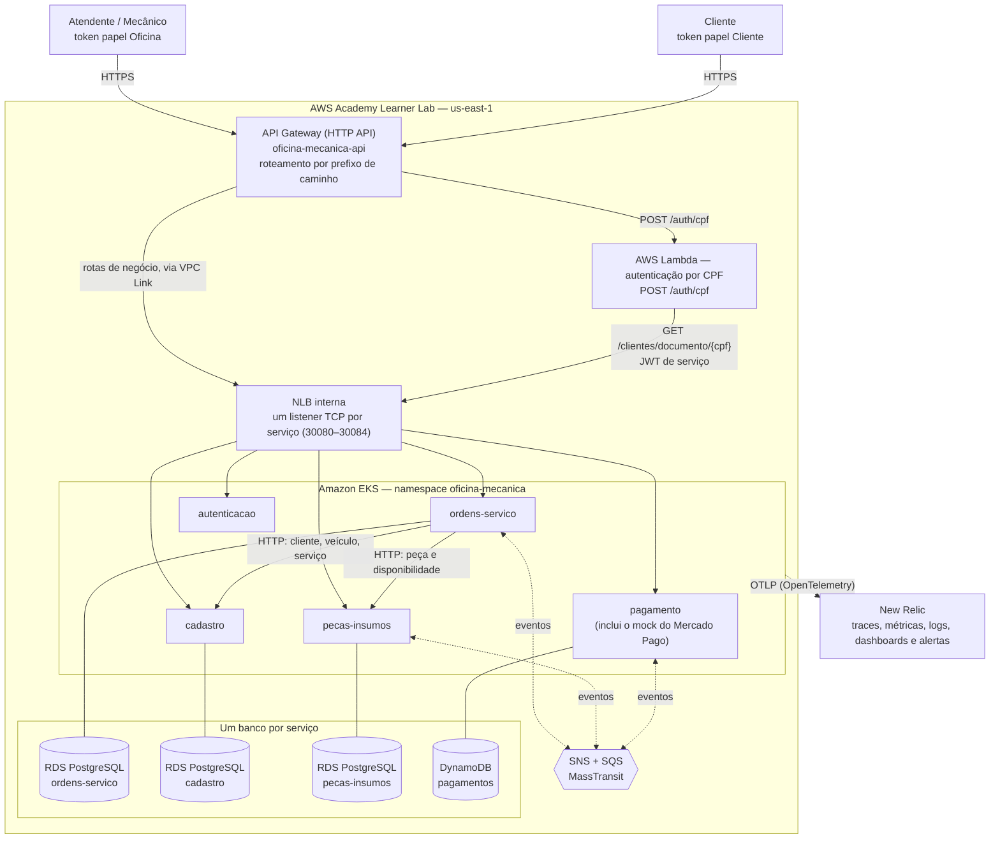
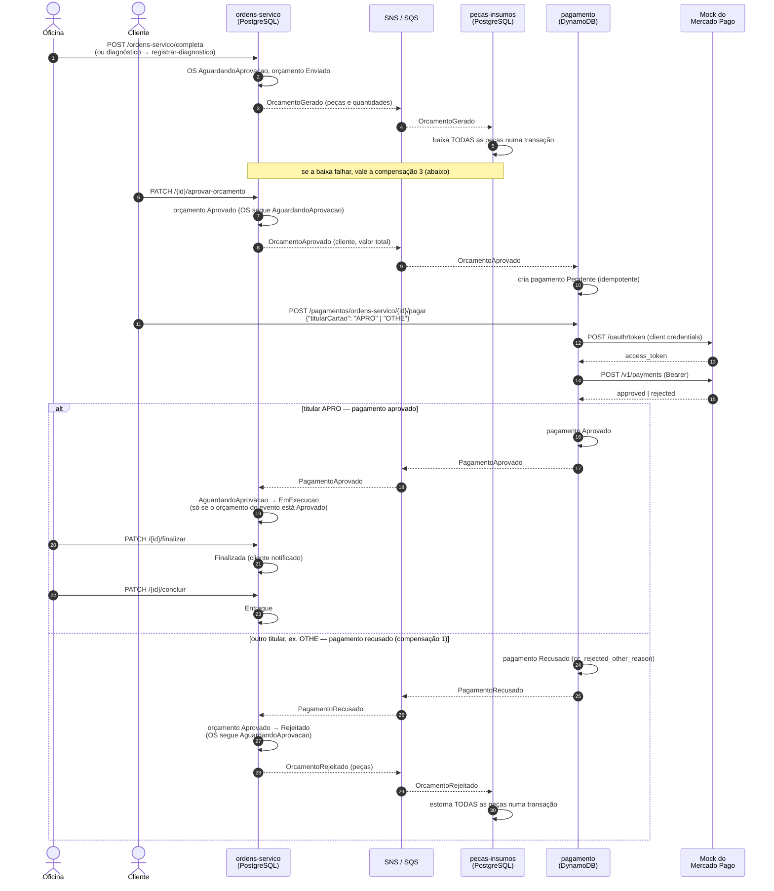
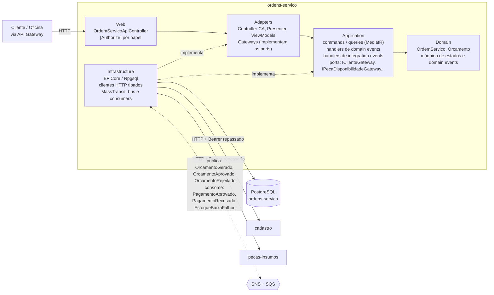

# Sistema de Oficina Mecânica — Microsserviços (Fase 4)

Back-end de um sistema integrado de atendimento e execução de serviços para oficina mecânica,
desenvolvido como **Tech Challenge da pós-graduação em Arquitetura de Software (FIAP/SOAT)**.

Na **Fase 4** o monólito modular das fases anteriores foi dividido em **cinco microsserviços**,
cada um em repositório, banco, imagem e pipeline próprios, ligados por **mensageria assíncrona** e por
uma **Saga coreografada** com compensação. **Este repositório (`oficina-mecanica-app`) é o serviço
OrdensServico** — o antigo monólito, que manteve o nome — **e também o ponto de entrada da
documentação geral do sistema distribuído**: o diagrama geral, a justificativa da divisão, a Saga e
os links para os demais repositórios estão aqui.

> 📚 A documentação detalhada está em [`docs/`](docs/README.md). Este README concentra o contexto
> geral e a documentação do serviço OrdensServico; cada outro serviço tem o próprio README.

---

## Índice

**Sistema distribuído**
- [Arquitetura geral](#arquitetura-geral)
- [Os serviços e a justificativa da divisão](#os-serviços-e-a-justificativa-da-divisão)
- [Saga coreografada](#saga-coreografada)
- [Tecnologias e por que foram escolhidas](#tecnologias-e-por-que-foram-escolhidas)
- [Mock do Mercado Pago](#mock-do-mercado-pago)
- [Repositórios do projeto](#repositórios-do-projeto)

**Serviço OrdensServico (este repositório)**
- [Propósito e responsabilidade](#propósito-e-responsabilidade)
- [Arquitetura do serviço](#arquitetura-do-serviço)
- [API, papéis e eventos](#api-papéis-e-eventos)
- [Configuração](#configuração)
- [Execução local](#execução-local)
- [Testes, BDD e cobertura](#testes-bdd-e-cobertura)
- [APIs — documentação e coleções](#apis--documentação-e-coleções)
- [Autenticação e autorização](#autenticação-e-autorização)
- [Observabilidade](#observabilidade-opentelemetry--new-relic)
- [CI/CD](#cicd)
- [Deploy na nuvem e a limitação da AWS Academy](#deploy-na-nuvem-e-a-limitação-da-aws-academy)
- [Vídeo demonstrativo](#vídeo-demonstrativo)

**Histórico**
- [Fases 1 a 3](#fases-1-a-3-resumo)
- [Documentação completa](#documentação-completa)

---

# Sistema distribuído

## Arquitetura geral



- **Entrada de tráfego:** o API Gateway roteia cada prefixo de caminho para a NLB interna, que tem um
  listener por serviço (porta = NodePort do serviço). O `autenticacao` emite o token da oficina; a
  Lambda emite o do cliente a partir do CPF.
- **Comunicação síncrona (HTTP):** só a OS consulta outros serviços — Cadastro (cliente, veículo,
  serviço) e PecasInsumos (peça e disponibilidade) —, repassando o token recebido. A Lambda consulta
  o Cadastro. REST complementa a mensageria, não a substitui.
- **Comunicação assíncrona (eventos):** OS, PecasInsumos e Pagamento trocam os eventos da
  [Saga](#saga-coreografada) por SNS/SQS. Cadastro e Autenticação não usam mensageria.
- **Bancos:** três PostgreSQL (uma instância RDS por serviço) e uma tabela DynamoDB; nenhum serviço
  acessa o banco de outro. O `autenticacao` não tem banco.
- **Observabilidade:** todos os serviços exportam traces, métricas e logs por OTLP para o New Relic,
  cada um com o próprio `service.name`; o trace atravessa as mensagens.

Os desenhos completos (componentes, infraestrutura, deploy, sequência de abertura da OS e Saga)
estão em [`docs/arquitetura/diagramas/`](docs/arquitetura/diagramas/).

## Os serviços e a justificativa da divisão

| Serviço | Repositório | Responsabilidade | Banco | Porta local | NodePort / NLB |
|---|---|---|---|---|---|
| **ordens-servico** | este (`oficina-mecanica-app`) | ciclo de vida da OS e do orçamento; orquestra o fluxo no sentido de negócio e participa da Saga | PostgreSQL | 8080 | 30080 |
| **autenticacao** | [`oficina-mecanica-autenticacao`](https://github.com/gabrielMauad/oficina-mecanica-autenticacao) | login da oficina e emissão do JWT (papel `Oficina`) | — | 8081 | 30081 |
| **cadastro** | [`oficina-mecanica-cadastro`](https://github.com/gabrielMauad/oficina-mecanica-cadastro) | clientes, veículos e catálogo de serviços | PostgreSQL | 8082 | 30082 |
| **pecas-insumos** | [`oficina-mecanica-pecas-insumos`](https://github.com/gabrielMauad/oficina-mecanica-pecas-insumos) | estoque de peças; baixa e estorno atômicos | PostgreSQL | 8083 | 30083 |
| **pagamento** | [`oficina-mecanica-pagamento`](https://github.com/gabrielMauad/oficina-mecanica-pagamento) | cobrança do orçamento aprovado (mock do Mercado Pago) | DynamoDB | 8084 | 30084 |

**Por que essa divisão** (decisão registrada na [ADR-009](docs/arquitetura/adrs/009-decomposicao-em-microsservicos.md)):

- **Um serviço por Bounded Context do monólito modular, mais Pagamento.** O monólito já tinha
  fronteiras físicas entre Cadastro, PecasInsumos, OrdensServico e Autenticacao — um projeto por
  camada por módulo, sem referências cruzadas, um schema por módulo. Extrair cada módulo é mover os
  seus projetos para um repositório novo e trocar os adapters (consulta em processo → HTTP; barramento
  em memória → mensageria); Domain e Application não mudam. Dividir por outro critério (como
  Billing/Execução, o exemplo do enunciado) obrigaria a romper fronteiras que já funcionavam —
  Execução e Produção, por exemplo, é só um status da OS, sem regra de negócio própria.
- **Pagamento é serviço novo.** O fluxo da OS não tinha pagamento e o enunciado o exige (Mercado Pago
  ou um mock que imite o fluxo). Ele acontece **depois da aprovação do orçamento e antes da
  execução**, pelo canal digital da oficina: a OS só é executada com o pagamento aprovado.
- **NoSQL no Pagamento.** O enunciado exige pelo menos um banco relacional e um não relacional. O
  Pagamento é o lugar natural do NoSQL: os registros são acessados por chave (OS + orçamento), sem
  junções — **DynamoDB**, com `OrdemServicoId` como chave de partição e `OrcamentoId` como chave de
  ordenação. Não foi preciso reescrever nenhum banco SQL já funcionando (mover o Cadastro, por
  exemplo, quebraria a Lambda de autenticação por CPF).
- **Autenticacao sem banco.** O login da oficina é simulado — a credencial do administrador vem de
  configuração —, então não há dado a persistir. A regra do enunciado pede banco próprio para quem
  persiste; não pede banco para quem não persiste.
- **Banco por serviço, isolado pela infraestrutura.** Cada PostgreSQL é uma instância RDS própria,
  criada por `for_each` no repositório de infra com segredo próprio no Secrets Manager.
- **`SharedKernel` e contratos de mensagem duplicados em cada repositório**, com os mesmos namespace
  e nomes de tipo (o MassTransit roteia pelo nome completo do tipo). Extrair para um pacote NuGet
  compartilhado é evolução futura.
- **Autenticação entre serviços:** JWT HS256 com segredo compartilhado
  ([ADR-001](docs/arquitetura/adrs/001-jwt-hs256-segredo-compartilhado.md)), validado por cada serviço.
  Consumidores de fila não fazem chamadas HTTP — os eventos carregam o que precisam.

## Saga coreografada

O fluxo da OS atravessa três bancos, então não há transação única: a consistência vem de uma
**Saga coreografada** ([ADR-010](docs/arquitetura/adrs/010-saga-coreografada-com-masstransit.md)).
Cada serviço publica um evento quando termina a sua etapa e reage aos eventos dos outros; se uma
etapa falha, os demais **desfazem** o que já fizeram (compensação).

**Por que coreografia e não orquestração:**

- o padrão de **integration events já existia** no código da Fase 3 (`IIntegrationEventBus`,
  `IIntegrationEventHandler<T>`) — a Saga o estende, sem introduzir um componente novo;
- são **poucos participantes** (três serviços) e o fluxo é **linear**, com poucos desvios;
- **não há ponto central de falha**: um orquestrador indisponível pararia todas as OS em andamento —
  e, para ser orquestração de verdade, ele teria de controlar todas as etapas, guardar o estado da
  Saga e tratar falhas e compensações, ou seja, um sexto serviço com estado próprio;
- cada compensação fica no serviço que conhece o estado a desfazer (o PecasInsumos estorna o próprio
  estoque; a OS rejeita o próprio orçamento).

### Fluxo completo



A OS **não ganha status novo**: o ciclo do pagamento (`Pendente` → `Aprovado` | `Recusado` |
`Cancelado`) é interno ao serviço de Pagamento, e a OS passa a `EmExecucao` **somente** pelo evento
`PagamentoAprovado` — a rota `PATCH /api/v1/ordens-servico/{id}/executar` deixou de existir.

### Eventos

| Evento | Publicado por | Consumido por | Efeito no consumidor |
|---|---|---|---|
| `OrcamentoGerado` | ordens-servico | pecas-insumos | baixa **atômica** de todas as peças; se falhar, publica `EstoqueBaixaFalhou` |
| `OrcamentoRejeitado` | ordens-servico (cliente rejeita **ou** pagamento recusado) | pecas-insumos | estorno atômico de todas as peças |
| `EstoqueBaixaFalhou` | pecas-insumos | ordens-servico; pagamento | **OS:** orçamento → `Rejeitado`, sem publicar `OrcamentoRejeitado`. **Pagamento:** se houver pagamento `Pendente` do orçamento, vai a `Cancelado` (sem evento) |
| `OrcamentoAprovado` | ordens-servico | pagamento | cria o pagamento `Pendente` |
| `PagamentoAprovado` | pagamento | ordens-servico | OS `AguardandoAprovacao` → `EmExecucao`, só se o orçamento do evento estiver `Aprovado` |
| `PagamentoRecusado` | pagamento | ordens-servico | compensação: orçamento `Aprovado` → `Rejeitado` + publica `OrcamentoRejeitado`; a OS segue `AguardandoAprovacao` |

### Compensações

| Falha | Compensação |
|---|---|
| **Pagamento recusado** | OS rejeita o orçamento aprovado → publica `OrcamentoRejeitado` → PecasInsumos **estorna as peças**. A OS segue `AguardandoAprovacao`, apta a novo diagnóstico e orçamento |
| **Orçamento rejeitado pelo cliente** | OS publica `OrcamentoRejeitado` → PecasInsumos **estorna as peças** (ainda não há pagamento) |
| **Falha na baixa de estoque** | PecasInsumos publica `EstoqueBaixaFalhou` → OS rejeita o orçamento **sem estorno** (a baixa é atômica: nada foi baixado) e o Pagamento cancela um pagamento `Pendente`, se existir |

**O que é retry, não compensação:** uma exceção técnica ao processar uma mensagem (banco
indisponível, timeout) é reentregue pelo MassTransit — três reentregas, após 1 s, 5 s e 10 s — antes
de desistir. Registrar e alertar uma falha (por exemplo, e-mail do orçamento que não pôde ser
enviado, ou `PagamentoAprovado` de um orçamento que não está mais `Aprovado`) também é tratamento de
erro, não compensação. Os consumidores toleram reentrega: se o estado já reflete o evento, registram
log e retornam sem erro.

> Detalhes, diagramas das três compensações e limitações conhecidas (sem outbox, sem DLQ gerenciada,
> corrida entre pagamento e falha de estoque) em
> [`docs/arquitetura/diagramas/saga.md`](docs/arquitetura/diagramas/saga.md).

## Tecnologias e por que foram escolhidas

| Tecnologia | Uso | Por quê |
|---|---|---|
| **.NET 10 / ASP.NET Core** | todos os serviços | stack do projeto desde a Fase 1 |
| **Clean Architecture + DDD** | todos os serviços | mantida do monólito; a Regra de Dependência é forçada por referências de projeto |
| **MediatR 12 + FluentValidation** | commands, queries e pipeline (validação, log, transação) | padrão existente; a Saga não alterou Application/Domain |
| **MassTransit 8** | publicação e consumo de eventos | licença aberta (a série 9 é comercial); propaga o `traceparent` W3C nas mensagens |
| **Amazon SNS + SQS** | transporte da mensageria | gerenciados e disponíveis na AWS Academy, sem broker no cluster; o MassTransit cria tópicos e filas na subida, sem Terraform de filas |
| **PostgreSQL 16 (RDS), uma instância por serviço** | OS, Cadastro e PecasInsumos | banco relacional já em uso; instância própria garante o isolamento pela infraestrutura |
| **Amazon DynamoDB** | Pagamento | banco não relacional exigido; acesso por chave, sem junções |
| **Mock do Mercado Pago** | processador de pagamento | aceito no lugar da integração real; imita o fluxo (token por credencial de cliente → pagamento), consumido por HTTP |
| **OpenTelemetry → New Relic** | traces, métricas e logs | observabilidade da Fase 3, agora distribuída ([RFC-004](docs/arquitetura/rfcs/004-ferramenta-de-observabilidade.md)) |
| **Docker, Kubernetes (EKS), HPA** | execução | um Deployment, Service NodePort e HPA (1–3 réplicas, 50% de CPU) por serviço |
| **Terraform** | infraestrutura | repositórios próprios para cluster/rede/API Gateway/ECR, bancos e Lambda |
| **AWS Lambda (.NET 8) + API Gateway + NLB** | autenticação por CPF e entrada de tráfego | exigidos pela Fase 3, mantidos |
| **GitHub Actions** | CI/CD independente por serviço | build → teste → qualidade → imagem (ECR) → deploy (EKS) → smoke test |
| **xUnit v3, Moq, Testcontainers** | testes unitários e de integração | padrão existente |
| **Reqnroll** | testes BDD | fluxo da Saga em Gherkin, no OrdensServico |
| **SonarCloud** | análise estática e cobertura | integrado ao CI (ver [Testes](#testes-bdd-e-cobertura)) |
| **LocalStack, Jaeger** | ambiente local | SNS/SQS/DynamoDB e traces sem depender da nuvem |

## Mock do Mercado Pago

O pagamento acontece no serviço [`pagamento`](https://github.com/gabrielMauad/oficina-mecanica-pagamento),
que **consome por HTTP** um mock do Mercado Pago hospedado no próprio serviço
(`MercadoPago__BaseUrl`), como consumiria a API real — por isso as chamadas aparecem nos traces.

**O que o mock simula** do fluxo real:

1. `POST /mock/mercadopago/oauth/token` — troca `client_id` / `client_secret`
   (`grant_type=client_credentials`) por um `access_token`; 401 se as credenciais não forem as
   configuradas. O token é assinado (HMAC) com as credenciais, então qualquer réplica do serviço o
   valida.
2. `POST /mock/mercadopago/v1/payments` — com o token como Bearer, cria o pagamento e devolve
   `approved` / `accredited` ou `rejected` / `cc_rejected_other_reason`.

O adapter do Pagamento faz exatamente essas duas chamadas, nessa ordem.

**Como pagar com `APRO` ou `OTHE`** (convenção dos cartões de teste do Mercado Pago, aplicada ao
`titularCartao`): com um token `Cliente` dono da OS e um pagamento `Pendente` (criado quando o cliente
aprova o orçamento):

```bash
curl -X POST http://localhost:8084/api/v1/pagamentos/ordens-servico/{ordemServicoId}/pagar \
  -H "Authorization: Bearer $TOKEN_CLIENTE" -H "Content-Type: application/json" \
  -d '{"titularCartao": "APRO"}'
```

| `titularCartao` | Resultado | Evento publicado | Efeito na OS |
|---|---|---|---|
| `APRO` | `Aprovado` | `PagamentoAprovado` | `AguardandoAprovacao` → `EmExecucao` |
| qualquer outro valor, ex. `OTHE` | `Recusado` (`cc_rejected_other_reason`) | `PagamentoRecusado` | orçamento `Rejeitado` e estorno das peças |

Isso permite demonstrar os dois caminhos da Saga ao vivo. **O que o mock não faz:** webhooks, estorno
de pagamento, validação real de cartão ou outros status do Mercado Pago. A integração real fica
fora do escopo. Na AWS, o mock **não** tem rota própria no API Gateway; a limitação conhecida (a
rota técnica `/pagamento/{proxy+}` também o alcança, protegido pelas credenciais e pelo Bearer) está
no README do serviço.

## Repositórios do projeto

| Repositório | Conteúdo |
|---|---|
| [`oficina-mecanica-app`](https://github.com/gabrielMauad/oficina-mecanica-app) | **este** — serviço OrdensServico e documentação geral |
| [`oficina-mecanica-cadastro`](https://github.com/gabrielMauad/oficina-mecanica-cadastro) | serviço Cadastro |
| [`oficina-mecanica-pecas-insumos`](https://github.com/gabrielMauad/oficina-mecanica-pecas-insumos) | serviço PecasInsumos |
| [`oficina-mecanica-pagamento`](https://github.com/gabrielMauad/oficina-mecanica-pagamento) | serviço Pagamento (DynamoDB + mock do Mercado Pago) |
| [`oficina-mecanica-autenticacao`](https://github.com/gabrielMauad/oficina-mecanica-autenticacao) | serviço Autenticação (login da oficina, sem banco) |
| [`oficina-mecanica-infra-k8s`](https://github.com/gabrielMauad/oficina-mecanica-infra-k8s) | Terraform: EKS, NLB, API Gateway, ECR por serviço, segredo da aplicação |
| [`oficina-mecanica-infra-db`](https://github.com/gabrielMauad/oficina-mecanica-infra-db) | Terraform: três instâncias RDS PostgreSQL, tabela DynamoDB e segredos |
| [`oficina-mecanica-lambda-auth`](https://github.com/gabrielMauad/oficina-mecanica-lambda-auth) | Lambda de autenticação do cliente por CPF e sua rota no API Gateway |

---

# Serviço OrdensServico

## Propósito e responsabilidade

Dono do **ciclo de vida da ordem de serviço e do orçamento**: abertura (simples ou completa),
diagnóstico, geração e envio do orçamento, decisão do cliente, execução, finalização e entrega. Na
Saga ele:

- **publica** `OrcamentoGerado`, `OrcamentoAprovado` e `OrcamentoRejeitado`;
- **consome** `PagamentoAprovado` (inicia a execução), `PagamentoRecusado` (compensa rejeitando o
  orçamento) e `EstoqueBaixaFalhou` (rejeita o orçamento sem estorno);
- **consulta por HTTP** o Cadastro (cliente, veículo, serviço) e o PecasInsumos (peça e
  disponibilidade), repassando o token recebido.

Banco: **PostgreSQL próprio** (schema `ordem_servico`; migrations aplicadas na partida). Status da OS:
`Recebida → EmDiagnostico → AguardandoAprovacao → EmExecucao → Finalizada → Entregue`; o orçamento
tem `Pendente | Enviado | Aprovado | Rejeitado`.

## Arquitetura do serviço

Clean Architecture em projetos físicos distintos; a Regra de Dependência é verificada em compilação
pelas referências de projeto.



- **Ports e adapters:** a Application depende só de *ports* (`IClienteGateway`, `IVeiculoGateway`,
  `IServicoGateway`, `IPecaDisponibilidadeGateway`, `IPecaInsumoInfoGateway`, `IIntegrationEventBus`).
  Os adapters de Cadastro e PecasInsumos são clientes HTTP tipados (um `DelegatingHandler` repassa o
  `Authorization` da requisição de entrada; 404 vira `null`); o adapter do barramento publica pelo
  `IPublishEndpoint` do MassTransit. Application e Domain **não** referenciam MassTransit, AWS SDK,
  `HttpClient`, EF Core ou ASP.NET.
- **Consumers MassTransit** (camada externa) apenas delegam ao `IIntegrationEventHandler<T>` da
  Application; em falha técnica registram `oficina.integracoes.falhas` e relançam a exceção para o
  retry atuar.
- **Eventos publicados depois do commit:** os domain events viram integration events enfileirados em
  `IPendingIntegrationEvents` e publicados pelo `TransactionBehavior` após o `SaveChanges`.
- **O e-mail do orçamento não derruba a Saga:** se montar ou enviar o e-mail falhar, o erro é
  registrado em log e na métrica de falhas, e `OrcamentoGerado` é publicado do mesmo jeito.

Diagramas C4 e a sequência de abertura da OS em
[`docs/arquitetura/diagramas/`](docs/arquitetura/diagramas/).

## API, papéis e eventos

### Rotas deste serviço

| Rota | Papel |
|---|---|
| `POST /api/v1/ordens-servico` — abre a OS (`Recebida`) | `Oficina` |
| `POST /api/v1/ordens-servico/completa` — abre já com serviços e peças | `Oficina` |
| `GET /api/v1/ordens-servico?clienteId=...` | `Oficina` |
| `GET /api/v1/ordens-servico/acompanhamento` — só as OS do cliente do token | `Cliente` |
| `GET /api/v1/ordens-servico/{id}` e `/{id}/status` | `Cliente` (só o dono) ou `Oficina` |
| `PATCH /{id}/iniciar-diagnostico`, `/{id}/registrar-diagnostico` | `Oficina` |
| `PATCH /{id}/aprovar-orcamento`, `/{id}/rejeitar-orcamento` | `Cliente` (só o dono) |
| `PATCH /{id}/finalizar`, `/{id}/concluir` | `Oficina` |

~~`PATCH /{id}/executar`~~ **foi removida**: a OS passa a `EmExecucao` pelo evento `PagamentoAprovado`.
Um `Cliente` que acessa a OS de outro recebe **403**, não 404. Além das rotas de negócio, o serviço
expõe `/healthz`, `/healthz/live`, `/healthz/ready`, `/openapi/v1.json` e `/scalar`.

### Rotas do sistema, por serviço (via API Gateway)

| Serviço | Rotas | Papel |
|---|---|---|
| autenticacao | `POST /api/v1/auth/login` | anônima |
| Lambda | `POST /auth/cpf` | anônima |
| cadastro | `/api/v1/clientes` (inclui `GET /clientes/documento/{documento}`, usada pela Lambda), `/api/v1/veiculos` (e `GET /clientes/{id}/veiculos`), `/api/v1/servicos` | `Oficina` |
| pecas-insumos | `/api/v1/pecas-insumos` (inclui `GET /{id}/disponibilidade?quantidade=n` e `PATCH /{id}/estoque/entrada` e `/saida`) | `Oficina` |
| ordens-servico | `/api/v1/ordens-servico/**` (tabela acima) | `Oficina` / `Cliente` |
| pagamento | `GET /api/v1/pagamentos/ordens-servico/{ordemServicoId}` | `Cliente` (só o dono) ou `Oficina` |
| pagamento | `POST /api/v1/pagamentos/ordens-servico/{ordemServicoId}/pagar` | `Cliente` (só o dono) |

Rotas técnicas por serviço, com reescrita de caminho (usadas pelo smoke test e para abrir o OpenAPI de
cada serviço): `<endpoint>/<serviço>/healthz/ready` e `<endpoint>/<serviço>/openapi/v1.json`.

### Eventos deste serviço

| Direção | Evento | Efeito |
|---|---|---|
| publica | `OrcamentoGerado` | orçamento gerado (abertura completa ou diagnóstico) → PecasInsumos baixa as peças |
| publica | `OrcamentoAprovado` | cliente aprovou → Pagamento cria o pagamento `Pendente` |
| publica | `OrcamentoRejeitado` | cliente rejeitou **ou** pagamento recusado → PecasInsumos estorna |
| consome | `PagamentoAprovado` | `AguardandoAprovacao` → `EmExecucao`, se o orçamento do evento está `Aprovado` |
| consome | `PagamentoRecusado` | orçamento `Aprovado` → `Rejeitado` e publica `OrcamentoRejeitado` |
| consome | `EstoqueBaixaFalhou` | orçamento → `Rejeitado`, sem `OrcamentoRejeitado` |

Filas deste serviço: `ordens-servico-pagamento-aprovado`, `ordens-servico-pagamento-recusado` e
`ordens-servico-estoque-baixa-falhou`.

## Configuração

| Chave | Uso |
|---|---|
| `ConnectionStrings__Default` | PostgreSQL do serviço (na nuvem, com `SSL Mode=Require`) |
| `Jwt__Secret`, `Jwt__Audience`, `Jwt__ValidIssuers__0` / `__1` | validação do JWT (`oficina-mecanica-api`; emissores `oficina-mecanica-app` e `oficina-mecanica-auth`) |
| `Mensageria__Transporte` | `AmazonSqs` (padrão; AWS e LocalStack) ou `InMemory` (testes) |
| `Mensageria__Regiao` | `us-east-1` |
| `Mensageria__ServiceUrl`, `Mensageria__AccessKey`, `Mensageria__SecretKey` | **só local** (LocalStack); vazios na AWS, onde vale a cadeia padrão de credenciais do SDK |
| `Servicos__Cadastro__BaseUrl`, `Servicos__PecasInsumos__BaseUrl` | URLs dos serviços consultados por HTTP; obrigatórias, validadas na partida |
| `OpenApi__Enabled` | liga/desliga Scalar e OpenAPI |
| `OTEL_SERVICE_NAME`, `OTEL_EXPORTER_OTLP_*` | observabilidade; `OTEL_SERVICE_NAME` padrão `oficina-mecanica-ordens-servico` |

## Execução local

Cada repositório tem o próprio `docker-compose.yml` com o serviço e as dependências exclusivas dele
(o Postgres próprio). As dependências **compartilhadas** — a rede Docker `oficina-local`, o
**LocalStack** (SNS, SQS e DynamoDB) e o **Jaeger** (traces) — sobem a partir **deste repositório**,
em `docker-compose.infra.yml`.

**Pré-requisitos:** Docker + Docker Compose v2 e Git. (.NET SDK 10 só para rodar os testes fora de
contêiner.)

```bash
# 1) clonar os cinco serviços lado a lado
for r in oficina-mecanica-app oficina-mecanica-autenticacao oficina-mecanica-cadastro \
         oficina-mecanica-pecas-insumos oficina-mecanica-pagamento; do
  git clone https://github.com/gabrielMauad/$r.git
done

# 2) infraestrutura compartilhada (uma vez): rede oficina-local + LocalStack + Jaeger
cd oficina-mecanica-app
docker compose -f docker-compose.infra.yml up -d

# 3) este serviço (OrdensServico) + o seu Postgres
docker compose up -d --build

# 4) os demais serviços, cada um no seu repositório
(cd ../oficina-mecanica-autenticacao  && docker compose up -d --build)
(cd ../oficina-mecanica-cadastro      && docker compose up -d --build)
(cd ../oficina-mecanica-pecas-insumos && docker compose up -d --build)
(cd ../oficina-mecanica-pagamento     && docker compose up -d --build)
```

Para percorrer a **Saga completa** os cinco serviços precisam estar no ar: a OS consulta Cadastro e
PecasInsumos por HTTP, e Pagamento e PecasInsumos trocam eventos com ela pelo LocalStack. As
migrations rodam sozinhas na partida de cada serviço com banco.

| Serviço | URL local | Observação |
|---|---|---|
| ordens-servico | `http://localhost:8080` | PostgreSQL em `localhost:5432` |
| autenticacao | `http://localhost:8081` | sem banco |
| cadastro | `http://localhost:8082` | PostgreSQL em `localhost:5433` |
| pecas-insumos | `http://localhost:8083` | PostgreSQL em `localhost:5434` |
| pagamento | `http://localhost:8084` | DynamoDB no LocalStack; tabela criada na partida |
| Scalar (docs interativa) | `http://localhost:<porta>/scalar` | um por serviço |
| Health checks | `http://localhost:<porta>/healthz/ready` | `/healthz/live` e `/healthz` também |
| Jaeger UI (traces) | `http://localhost:16686` | selecione o serviço e abra o trace |
| LocalStack | `http://localhost:4566` | SNS, SQS e DynamoDB |

Credenciais de desenvolvimento (somente local): banco `oficina` / `oficina-dev-pass`; admin da
oficina `admin@oficina.com` / `admin123`; `Jwt__Secret=docker-dev-secret-key-replace-in-prod-000`;
credenciais do mock do Mercado Pago `mp-dev-client` / `mp-dev-secret`.

```bash
# todos prontos? (esperado: 200 nas cinco portas)
for p in 8080 8081 8082 8083 8084; do echo -n "$p: "; curl -s -o /dev/null -w "%{http_code}\n" localhost:$p/healthz/ready; done
```

**Token do cliente em ambiente local.** A Lambda de autenticação por CPF só existe na nuvem; local,
o token `Cliente` é um JWT HS256 assinado com o mesmo `Jwt__Secret`, com as claims que a Lambda
emitiria (`iss=oficina-mecanica-auth`, `aud=oficina-mecanica-api`, `role=Cliente`, `sub=<id do cliente>`):

```bash
node -e '
const c=require("crypto"),b=x=>Buffer.from(x).toString("base64url");
const h=b(JSON.stringify({alg:"HS256",typ:"JWT"})),now=Math.floor(Date.now()/1000);
const p=b(JSON.stringify({iss:"oficina-mecanica-auth",aud:"oficina-mecanica-api",sub:process.argv[1],role:"Cliente",iat:now,exp:now+3600}));
console.log(h+"."+p+"."+c.createHmac("sha256","docker-dev-secret-key-replace-in-prod-000").update(h+"."+p).digest("base64url"))' <clienteId>
```

**Roteiro da Saga na coleção.** A pasta **"Fluxo da Saga"** da [coleção](#apis--documentação-e-coleções)
reúne as requisições na ordem: login → cadastros → abertura da OS → aprovar → consultar o pagamento →
pagar (`APRO` ou `OTHE`) → conferir a OS → finalizar → concluir. Para a compensação, pague com `OTHE`
e confira a OS (`orcamentos: Rejeitado`), o estoque estornado e o pagamento `Recusado`.

Os guias [`teste-cenario-feliz`](docs/guias/teste-cenario-feliz.md) e
[`teste-cenarios-alternativos`](docs/guias/teste-cenarios-alternativos.md) descrevem os fluxos de OS
das fases anteriores em uma única URL; ver o aviso no início de cada um.

## Testes, BDD e cobertura

```bash
# Tudo: unitários + integração + BDD (integração e BDD precisam de Docker — Testcontainers PostgreSQL)
dotnet test OficinaMecanica.slnx

# Só os projetos que não usam Docker: domínio, Application, adapters, infraestrutura e SharedKernel
for p in tests/Modules/OrdensServico/OrdemServico.Domain.Tests \n         tests/Modules/OrdensServico/OrdemServico.Application.Tests \n         tests/Modules/OrdensServico/OrdemServico.Adapters.Tests \n         tests/Modules/OrdensServico/OrdemServico.Infrastructure.Tests \n         tests/SharedKernel/SharedKernel.Application.Tests; do dotnet test $p; done

# Só integração (Docker)
dotnet test tests/IntegrationTests
```

| Camada | Ferramenta | O que cobre |
|---|---|---|
| Domínio e Application | xUnit v3 + Moq | máquina de estados da OS e do orçamento, commands, handlers da Saga |
| Infraestrutura / adapters | xUnit v3 + Moq | consumers, adapter do barramento, gateways HTTP |
| Integração | `WebApplicationFactory` + Testcontainers.PostgreSql + test harness do MassTransit | a aplicação inteira com banco real, publicando e consumindo mensagens em memória |
| **BDD** | **Reqnroll** (xUnit v3) | fluxo completo da OS e compensações da Saga |

### BDD

Fica em [`tests/OrdensServico.Bdd`](tests/OrdensServico.Bdd): a feature
[`FluxoOrdemServico.feature`](tests/OrdensServico.Bdd/Features/FluxoOrdemServico.feature) (Gherkin
em português) e os steps em `Steps/`. Os cenários:

1. fluxo completo com pagamento aprovado, da abertura à entrega do veículo;
2. pagamento recusado: devolve as peças e permite novo diagnóstico;
3. falha na baixa de estoque: rejeita o orçamento sem estorno;
4. pagamento aprovado de um orçamento já rejeitado não coloca a OS em execução;
5. rejeição pelo cliente publica `OrcamentoRejeitado` para o estorno.

Roda a aplicação inteira com um PostgreSQL real (Testcontainers). **Cadastro e PecasInsumos
(chamadas HTTP) são simulados por gateways falsos**; **Pagamento e PecasInsumos (mensageria) são
simulados publicando eventos e inspecionando as mensagens publicadas** pelo test harness do
MassTransit — o BDD valida a OS como participante da Saga, não os outros serviços. Para rodar só o BDD
(requer Docker):

```bash
dotnet test tests/OrdensServico.Bdd/OrdensServico.Bdd.csproj
```

### Cobertura (meta ≥ 80% por serviço)

A cobertura de linhas é medida sobre todas as assemblies de `src/` (excluídos apenas migrations,
`Program.cs` e código gerado — ver [`coverage.runsettings`](coverage.runsettings)) e o CI **falha**
abaixo de 80%. Evidência no último run verde do CI (build & testes do PR #54):
**93,6% de linhas e 85,1% de ramos** —
[ver o passo "Gate de cobertura"](https://github.com/gabrielMauad/oficina-mecanica-app/actions/runs/43551781849).

```bash
dotnet test OficinaMecanica.slnx --settings coverage.runsettings --collect:"XPlat Code Coverage" --results-directory coverage-results/
reportgenerator -reports:"coverage-results/**/coverage.opencover.xml" -targetdir:"coverage-report/" -reporttypes:Html
```

**SonarCloud:** o CI já executa a análise (passos `sonarscanner begin/end` com os resultados de
cobertura), condicionada ao secret `SONAR_TOKEN` e às variables `SONAR_PROJECT_KEY` /
`SONAR_ORGANIZATION` do repositório. <!-- sonarcloud-link --> O link público do projeto no
SonarCloud será adicionado aqui quando a conta estiver configurada.

## APIs — documentação e coleções

| Recurso | Onde |
|---|---|
| **Scalar / OpenAPI** | local: `http://localhost:<porta>/scalar` e `/openapi/v1.json`; nuvem: `<endpoint>/<serviço>/openapi/v1.json` (ex.: `/ordens-servico/openapi/v1.json`) |
| **Coleção Bruno** | [`docs/guias/collection_bruno.yml`](docs/guias/collection_bruno.yml) — todos os serviços, ambientes `Local` e `Nuvem` |
| **Coleção Postman** | [`docs/guias/collection_postman.json`](docs/guias/collection_postman.json) + ambientes [`Local`](docs/guias/postman_environment_local.json) e [`Nuvem`](docs/guias/postman_environment_nuvem.json) — mesma cobertura da coleção Bruno |

As duas coleções cobrem Autenticação, Cadastro, PecasInsumos, OrdensServico e Pagamento (incluindo a
rota nova de cliente por documento e a de disponibilidade), a autenticação por CPF da Lambda, o mock do
Mercado Pago (somente local) e a pasta **"Fluxo da Saga"**; a rota `/executar` não existe mais. O
ambiente `Local` tem **uma URL por serviço** (`8080`–`8084`); o ambiente `Nuvem` aponta todos para o
**API Gateway** (descoberto com o comando abaixo). Preencha `token_oficina` com o `token` de
**Autenticação > Login**; `token_cliente` vem da Lambda (`POST /auth/cpf`, na nuvem) ou do JWT manual
(local) descrito em [Execução local](#execução-local).

## Autenticação e autorização

Praticamente todos os endpoints exigem JWT HS256, e a autorização considera o **papel** do token —
[RFC-001](docs/arquitetura/rfcs/001-estrategia-de-autenticacao.md) e
[ADR-003](docs/arquitetura/adrs/003-dois-emissores-e-autorizacao-por-papel.md). O segredo é
compartilhado e cada serviço apenas **valida** o token.

| Papel | Quem é | Quem emite | Credencial |
|---|---|---|---|
| `Oficina` | operador da oficina | serviço **autenticacao** — `POST /api/v1/auth/login` | e-mail + senha |
| `Cliente` | cliente da oficina | **Lambda** — `POST /auth/cpf` | CPF |

Ambos os tokens valem 1 hora e vão em `Authorization: Bearer <token>`. Um `Cliente` só opera sobre
recursos **do próprio cliente** (o `sub` do token é comparado com o dono da OS ou do pagamento); caso
contrário, **403**. A OpenAPI/Scalar continua acessível sem autenticação
([RFC-001 §8](docs/arquitetura/rfcs/001-estrategia-de-autenticacao.md)).

## Observabilidade (OpenTelemetry + New Relic)

Traces, métricas e logs via **OpenTelemetry .NET**, exportados por **OTLP** ao **New Relic**
([RFC-004](docs/arquitetura/rfcs/004-ferramenta-de-observabilidade.md); correlação log↔trace em
[ADR-004](docs/arquitetura/adrs/004-correlacao-via-traceid-w3c.md)). Cada serviço se identifica por
`OTEL_SERVICE_NAME`:

| Serviço | `service.name` |
|---|---|
| ordens-servico | `oficina-mecanica-ordens-servico` |
| autenticacao | `oficina-mecanica-autenticacao` |
| cadastro | `oficina-mecanica-cadastro` |
| pecas-insumos | `oficina-mecanica-pecas-insumos` |
| pagamento | `oficina-mecanica-pagamento` |

- **Rastreamento distribuído:** a fonte `MassTransit` está registrada no tracer; o `traceparent`
  atravessa as mensagens, então um único trace cobre requisição HTTP → publicação (`<Evento> send`) →
  consumo (`<fila> receive` / `process`) → publicação seguinte. Localmente, no Jaeger; na nuvem, no
  New Relic.
- **Métricas de negócio** deste serviço (`OficinaMecanica.OrdensServico`:
  `oficina.ordens_servico.abertas`, `oficina.ordens_servico.etapa.duracao`) e de falhas de
  integração (`OficinaMecanica.Integracoes`: `oficina.integracoes.falhas`, por `evento` e
  `handler`) — contrato em [`docs/arquitetura/metricas.md`](docs/arquitetura/metricas.md).
- **Dashboard e alertas:** [`docs/observabilidade/`](docs/observabilidade/) — dashboard importável
  com visão por serviço e da Saga, condições de alerta em NRQL e monitor sintético.
- **CPU/memória do cluster** vêm do `nri-bundle` (Helm), instalado **somente pela pipeline deste
  serviço** ([`k8s/observabilidade/newrelic-values.yaml`](k8s/observabilidade/newrelic-values.yaml)).
- **Amostragem em 100%** (`AlwaysOnSampler`, ADR-004): deliberada para o volume do projeto, não
  adequada a produção real. No ambiente `Testing` nada disso é registrado.

## CI/CD

Pipeline **independente por serviço**, em dois workflows do GitHub Actions:

| Workflow | Gatilho | O que faz |
|---|---|---|
| [`ci.yml`](.github/workflows/ci.yml) | Pull Request → `main` | build, testes com cobertura, gate de 80% e SonarCloud (job `Build & Test`, exigido pela proteção da `main`) |
| [`ci-cd.yml`](.github/workflows/ci-cd.yml) | push na `main`, `workflow_dispatch` | **build-test** → **docker-image** (Amazon ECR, tag = SHA) → **deploy** no EKS → smoke test `GET <endpoint>/ordens-servico/healthz/ready` pelo API Gateway |

A proteção da `main` (Pull Request obrigatório e o job `Build & Test` como checagem exigida) é configuração do
repositório no GitHub, não código: está ativa neste repositório e deve ter a mesma regra em cada repositório
de serviço. O deploy cria
o `Secret` `ordens-servico-secrets` em tempo de execução a partir do Secrets Manager (com
`::add-mask::`), aplica ConfigMap, Deployment, Service e HPA, espera o `rollout` e instala o
`nri-bundle`. Cada serviço tem pipelines equivalentes no próprio repositório.

> Desenho do fluxo: [`docs/arquitetura/diagramas/fluxo-deploy.md`](docs/arquitetura/diagramas/fluxo-deploy.md).

## Deploy na nuvem e a limitação da AWS Academy

A infraestrutura é persistente e provisionada por Terraform em repositórios próprios; este
repositório publica **apenas o seu serviço** nela. Ordem de provisionamento (há dependência real entre
eles, via `terraform_remote_state` e recursos consumidos pelas pipelines):

| Ordem | Repositório | Provisiona |
|---|---|---|
| 1 | [`oficina-mecanica-infra-k8s`](https://github.com/gabrielMauad/oficina-mecanica-infra-k8s) | cluster **EKS** (nós `t3.medium`, 2–4), NLB com um listener por serviço, **API Gateway** com as rotas, um **ECR** por serviço, segredo da aplicação |
| 2 | [`oficina-mecanica-infra-db`](https://github.com/gabrielMauad/oficina-mecanica-infra-db) | três **RDS PostgreSQL** (um por serviço, segredos próprios) e a tabela **DynamoDB** de pagamentos |
| 3 | cada serviço (este repositório e os outros quatro) | imagem no ECR + manifestos `k8s/` do serviço no cluster |
| 4 | [`oficina-mecanica-lambda-auth`](https://github.com/gabrielMauad/oficina-mecanica-lambda-auth) | Lambda de autenticação por CPF e a rota `POST /auth/cpf` |

**Descobrir a URL da API** (nunca fica hardcoded; muda a cada recriação da infraestrutura):

```bash
aws apigatewayv2 get-apis \
  --query "Items[?Name=='oficina-mecanica-api'].ApiEndpoint | [0]" \
  --output text
```

**Senha do admin da oficina** (gerada pelo Terraform de `oficina-mecanica-infra-k8s`, nunca commitada):

```bash
aws secretsmanager get-secret-value --secret-id oficina-mecanica/dev/app \
  --query SecretString --output text | jq -r .admin_senha
```

**Limitação do deploy automático (AWS Academy).** A conta AWS Academy Learner Lab não permite criar IAM
role nem provedor OIDC; as pipelines autenticam com **credenciais de sessão temporárias**
(`AWS_ACCESS_KEY_ID`, `AWS_SECRET_ACCESS_KEY`, `AWS_SESSION_TOKEN`), renovadas manualmente a cada
sessão do laboratório em **cada repositório** com deploy
([ADR-006](docs/arquitetura/adrs/006-credenciais-de-nuvem-no-cicd.md)). **Se o job `deploy` falhar na
autenticação, não é pipeline quebrada — é a sessão expirada:** renove os três secrets do repositório
(environment `aws-academy`) e reexecute via `workflow_dispatch`, sem precisar de um commit novo.

Manifestos em [`k8s/`](k8s/): `00-namespace.yaml` (compartilhado), `01-configmap.yaml`, `10-deployment.yaml`
(probes `/healthz/live` e `/healthz/ready`, requests 100m/256Mi, limits 500m/512Mi), `11-service.yaml`
(**NodePort 30080**, alvo do listener da NLB — não altere) e `12-hpa.yaml` (1 a 3 réplicas, 50% de CPU).

> Desenho da infraestrutura: [`docs/arquitetura/diagramas/infraestrutura.md`](docs/arquitetura/diagramas/infraestrutura.md).

## Vídeo demonstrativo

> 🎥 **Fase 4:** <!-- video-fase-4 --> o link do vídeo será adicionado aqui. Roteiro: fluxo completo da
> OS pelos serviços, Saga e tratamento de falhas (compensação por pagamento recusado), pipeline e
> deploy de um serviço com validação dos testes, e monitoramento com rastreamento distribuído.
>
> Fase 3 (arquitetura em nuvem): <https://youtu.be/ZnaUtgUUb5I>.

---

# Histórico

## Fases 1 a 3 (resumo)

- **Fase 1** — back-end **monolítico** com DDD, APIs REST, autenticação JWT e testes.
- **Fase 2** — refatoração para **Clean Code + Clean Architecture**, novas APIs de OS (abertura
  completa, aprovação/recusa de orçamento, acompanhamento ordenado por status) e infraestrutura
  (Docker, Kubernetes, Terraform, CI/CD, HPA). Planos em
  [`docs/planos/refatoracao-clean-architecture/`](docs/planos/refatoracao-clean-architecture/) e
  [`docs/planos/infra-fase-2/`](docs/planos/infra-fase-2/).
- **Fase 3** — nuvem (AWS Academy): **EKS**, **RDS**, **API Gateway**, **Lambda** de autenticação por CPF,
  observabilidade com OpenTelemetry + New Relic, RFCs e ADRs 001–008. Análise em
  [`docs/planos/fase-3/`](docs/planos/fase-3/00-analise-da-spec.md).

O sistema era um **Modular Monolith**: quatro Bounded Contexts com fronteiras físicas, um único
PostgreSQL com um schema por módulo e um barramento de eventos em processo. Na Fase 4 cada módulo
virou um serviço e o barramento em memória virou mensageria (ver [ADR-009](docs/arquitetura/adrs/009-decomposicao-em-microsservicos.md)
e [ADR-010](docs/arquitetura/adrs/010-saga-coreografada-com-masstransit.md)).

## Documentação completa

Índice navegável: **[`docs/README.md`](docs/README.md)**.

| Tema | Pasta |
|---|---|
| Arquitetura, diagramas, RFCs e ADRs | [`docs/arquitetura/`](docs/arquitetura/) |
| Saga e compensações | [`docs/arquitetura/diagramas/saga.md`](docs/arquitetura/diagramas/saga.md) |
| Coleções (Bruno e Postman) e guias de teste | [`docs/guias/`](docs/guias/) |
| Dashboard, alertas e uptime (New Relic) | [`docs/observabilidade/`](docs/observabilidade/) |
| Planos de implementação | [`docs/planos/`](docs/planos/) |
| Enunciados oficiais (FIAP) | [`docs/spec/`](docs/spec/) |

---

## Licença

Ver [`LICENSE`](LICENSE).
