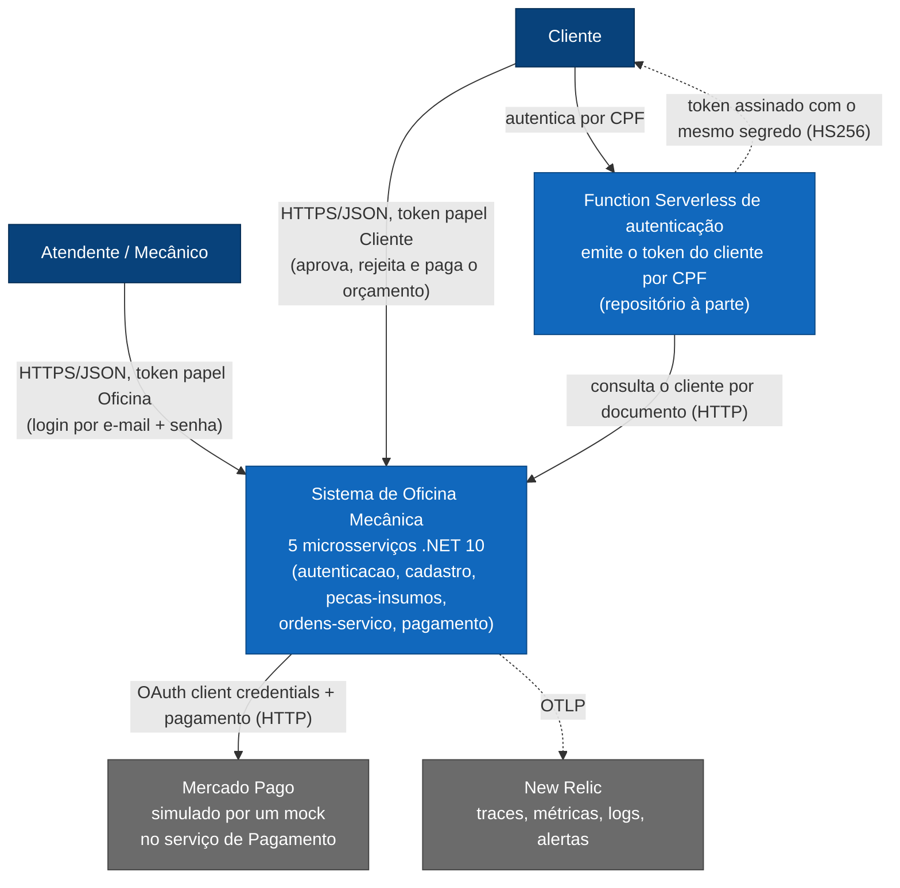
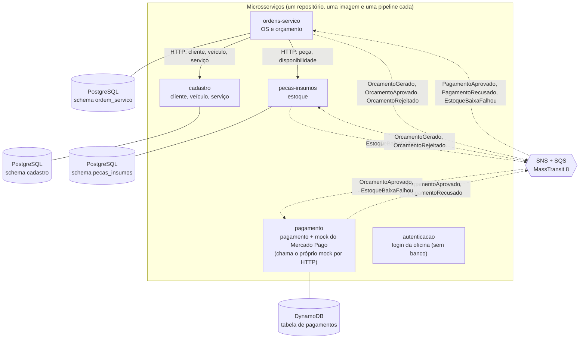
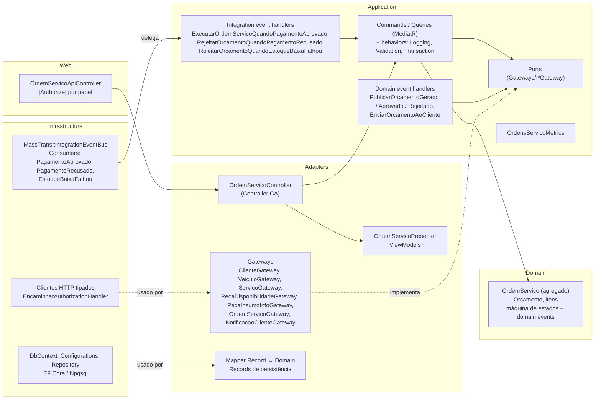
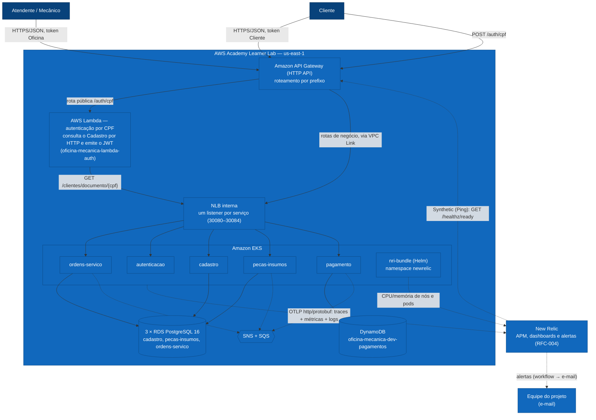

# Desenho — Componentes do Sistema

> Modelo C4 (níveis 1 → 4) do **Sistema de Oficina Mecânica** na **Fase 4**: cinco microsserviços
> .NET 10, cada um com Clean Architecture, ligados por HTTP e por mensageria. O nível 4 mostra a
> implantação na AWS ([RFC-002](../rfcs/002-escolha-do-provedor-de-nuvem.md)); o detalhamento da
> infraestrutura está em [`infraestrutura.md`](infraestrutura.md) e o fluxo da Saga em
> [`saga.md`](saga.md).
> Diagramas em [Mermaid](https://mermaid.js.org/) — renderizam nativamente no GitHub.
>
> Documentação de apoio: [`estrutura-do-projeto.md`](../estrutura-do-projeto.md),
> [`clean-architecture.md`](../clean-architecture.md),
> [ADR-009](../adrs/009-decomposicao-em-microsservicos.md).

---

## Nível 1 — Contexto

Quem usa o sistema e com o que ele fala. O Mercado Pago é **simulado**: um mock hospedado no
próprio serviço de Pagamento imita o fluxo real (token por credencial de cliente → pagamento). O
e-mail de orçamento também é simulado (log).

**Dois emissores de token, autorização por papel.** O serviço `autenticacao` emite o token do
atendente (`POST /api/v1/auth/login`, papel `Oficina`); a Function Serverless emite o do cliente a
partir do CPF (papel `Cliente`). Ambos são HS256 com o mesmo segredo e se distinguem por `iss` e pela
claim `role` — [RFC-001](../rfcs/001-estrategia-de-autenticacao.md),
[ADR-001](../adrs/001-jwt-hs256-segredo-compartilhado.md),
[ADR-003](../adrs/003-dois-emissores-e-autorizacao-por-papel.md). Cada serviço apenas valida o token.
A Function **não lê mais banco**: consulta o Cadastro por HTTP
([ADR-011](../adrs/011-lambda-consulta-o-cadastro-por-http.md)).

---

## Nível 2 — Containers (serviços)

Cada Bounded Context do antigo monólito virou um serviço, e o Pagamento é novo
([ADR-009](../adrs/009-decomposicao-em-microsservicos.md)). Cada um tem repositório, imagem, pipeline
e — quando persiste dados — banco próprios. O barramento é o SNS/SQS, configurado pelo MassTransit
([ADR-010](../adrs/010-saga-coreografada-com-masstransit.md)).

**Comunicação entre serviços** — nenhum serviço acessa o banco de outro:

| Tipo | Quando | Mecanismo |
|---|---|---|
| **Síncrona (HTTP)** | precisa de resposta imediata (cliente existe? peça disponível?) — só a OS consulta, e a Lambda consulta o Cadastro | *port* na Application do consumidor + *adapter* HTTP na camada externa; o `Authorization` da requisição de entrada é repassado; 404 vira `null` |
| **Assíncrona (eventos)** | fato consumado a que outro serviço reage (orçamento gerado → baixa de estoque; pagamento aprovado → execução) | evento de integração publicado **depois do commit** pelo `IIntegrationEventBus`; consumers MassTransit delegam ao `IIntegrationEventHandler<T>` da Application |

Consumidores de fila **não** fazem chamadas HTTP: os eventos carregam o que for preciso.

---

## Nível 3 — Componentes de um serviço (Clean Architecture)

Recorte do **OrdensServico**, o serviço mais completo. Cada anel da Clean Architecture é um projeto
físico; a Regra de Dependência é verificada em compilação — as setas apontam sempre para dentro. Os
demais serviços seguem a mesma estrutura.

**Persistência sem acoplar o Domain (DTOs de persistência):** o EF Core mapeia **Records**
(`OrdemServicoRecord`, etc., em `Adapters/DataSources/Records`), **nunca o agregado de Domain**. O
`DbContext`, as `Configurations` e o `Repository` da Infrastructure só conhecem Records; o `Mapper`
converte Record ↔ Domain dentro do Gateway. O Domain não tem nenhuma referência a EF/Npgsql
_(refatoração da Fase 2 — ver
[`../../planos/refatoracao-clean-architecture/07-plano-dtos-persistencia.md`](../../planos/refatoracao-clean-architecture/07-plano-dtos-persistencia.md))_.

**Contratos.** Há dois projetos de contratos, ambos fora dos quatro anéis:
- `OficinaMecanica.Contracts` — os **eventos de integração** (`OrcamentoGerado`, `OrcamentoAprovado`,
  `OrcamentoRejeitado`, `EstoqueBaixaFalhou`, `PagamentoAprovado`, `PagamentoRecusado`). É uma
  **cópia idêntica em cada repositório** que publica ou consome, com os mesmos namespace e nomes de
  tipo — o MassTransit roteia pelo nome completo do tipo. Depende apenas de `SharedKernel.Domain`.
- `OrdensServico.Contracts` — consultas e DTOs herdados da época do monólito, usados internamente
  pelo serviço; nenhum outro serviço o referencia.

**Regra de Dependência** — referências permitidas por camada:

| Camada | Depende de |
|---|---|
| **Domain** | `SharedKernel.Domain` apenas |
| **Application** | Domain, SharedKernel.*, `OficinaMecanica.Contracts`, `OrdensServico.Contracts` — **sem** MassTransit, AWS SDK, `HttpClient`, EF Core ou ASP.NET |
| **Adapters** | Application, Domain, Contracts, MediatR — **sem ASP.NET/EF** |
| **Infrastructure** | Application, Domain, Contracts, Adapters, EF Core/Npgsql, MassTransit, clientes HTTP |
| **Web** | Adapters, SharedKernel.* |

> Detalhamento em [`estrutura-do-projeto.md`](../estrutura-do-projeto.md) e
> [`clean-architecture.md`](../clean-architecture.md).

---

## Nível 4 — Implantação em Nuvem (AWS Academy Learner Lab)

Visão de **implantação**: onde cada componente roda e como se falam na AWS, conforme o
[RFC-002](../rfcs/002-escolha-do-provedor-de-nuvem.md). O desenho completo — VPC Link, NodePorts,
Secrets Manager, ECR, repositórios Terraform — está em [`infraestrutura.md`](infraestrutura.md).

Todas as caixas estão **implementadas e provisionadas**. A Function Serverless **não é
instrumentada**: roda em subnet sem NAT Gateway, sem alcance à internet para exportar OTLP (ADR-004,
RFC-004). As restrições reais da conta (sem criação de IAM role própria, VPC default sem NAT, limites
de dimensionamento) estão na seção 6 do RFC-002.
