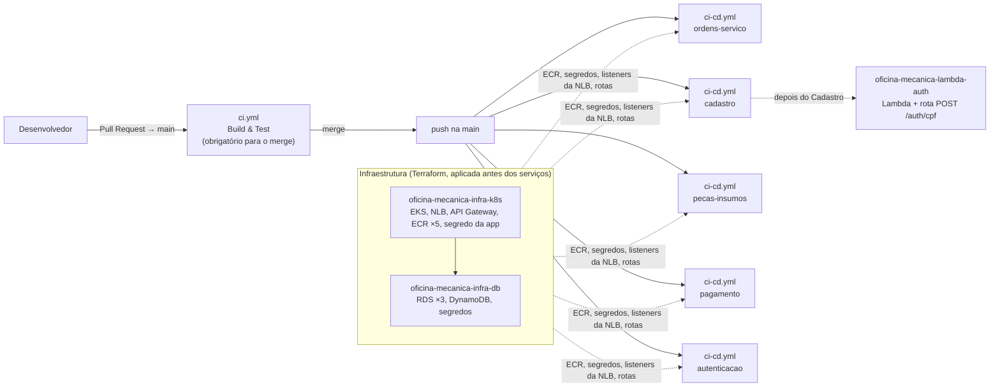
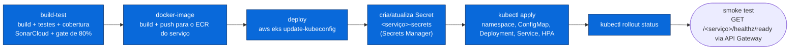

# Desenho — Fluxo de Deploy (CI/CD)

> Na Fase 4 cada serviço tem a **própria pipeline**, independente das demais, no **GitHub Actions**,
> publicando na infraestrutura de nuvem persistente (AWS Academy Learner Lab — ver
> [`infraestrutura.md`](infraestrutura.md)): build → teste e qualidade → imagem (**Amazon ECR**) →
> deploy no **EKS** → smoke test via **API Gateway**. A infraestrutura (cluster, rede, bancos,
> filas de mensageria, API Gateway, ECR) **não é criada pelas pipelines dos serviços**: nasce dos
> repositórios Terraform `oficina-mecanica-infra-k8s` e `oficina-mecanica-infra-db`.
>
> Workflows deste serviço: [`ci.yml`](../../../.github/workflows/ci.yml) (PRs) e
> [`ci-cd.yml`](../../../.github/workflows/ci-cd.yml) (push na `main` e `workflow_dispatch`). Os
> outros quatro repositórios de serviço têm `ci.yml` e `ci-cd.yml` equivalentes.
> Plano original da Fase 2 (cluster kind) em
> [`../../planos/infra-fase-2/04-cicd.md`](../../planos/infra-fase-2/04-cicd.md) — documento
> histórico, mantido como registro do que existiu, não como estado atual.

---

## Visão geral: uma pipeline por repositório

Os cinco serviços são implantados de forma independente: um deploy não espera nem reinicia os outros.
A Lambda de autenticação é provisionada depois do Cadastro, de quem passa a depender.

## Etapas do `ci-cd.yml` (igual em todos os serviços)

| Job | Depende de | O que faz |
|---|---|---|
| **build-test** (`Build & Test`) | — | `dotnet restore/build --configuration Release` → testes com cobertura (`coverage.runsettings`) → análise do **SonarCloud** (`sonarscanner begin/end`, condicionada ao secret `SONAR_TOKEN` e às variables `SONAR_PROJECT_KEY`/`SONAR_ORGANIZATION`) → **gate de cobertura**: falha se a cobertura de linhas do serviço for menor que 80% |
| **docker-image** | build-test | autentica na AWS (credenciais de sessão), login no **Amazon ECR**, `docker build` a partir da raiz e push para o repositório do serviço (`oficina-mecanica-<serviço>`) com a tag do `${{ github.sha }}` |
| **deploy** | docker-image | `aws eks update-kubeconfig` → aplica o namespace → cria/atualiza o `Secret` `<serviço>-secrets` a partir do Secrets Manager (lidos por nome) → aplica `ConfigMap`, `Deployment` (com a imagem recém-publicada), `Service` e `HPA` do serviço → `kubectl rollout status` → **smoke test** em `<endpoint>/<serviço>/healthz/ready`, via o endpoint do API Gateway descoberto pelo **nome** |

- **Segredos do `<serviço>-secrets`:** a connection string do RDS do serviço (com `SSL Mode=Require`),
  o segredo JWT e o header OTLP (`api-key=<license key do New Relic>`); o `autenticacao` acrescenta a
  senha do admin e o `pagamento`, as credenciais do mock do Mercado Pago. Nenhum valor é impresso no
  log (`::add-mask::` antes do primeiro uso).
- **Smoke test pela rota técnica:** `GET /<serviço>/healthz/ready` chega ao pod como
  `GET /healthz/ready` (reescrita de caminho do API Gateway), validando a cadeia inteira: API
  Gateway → VPC Link → NLB → NodePort → pod → dependências do serviço (o banco, no caso dos que o
  têm). Com retentativas, porque a NLB leva alguns minutos para marcar o alvo como saudável.
- **Monitoramento do cluster:** o `nri-bundle` (New Relic Kubernetes integration) é instalado **só**
  pela pipeline do `ordens-servico`, depois do smoke test, para que uma falha do agente não bloqueie
  a subida do serviço. As métricas de CPU e memória são do cluster inteiro; os demais serviços enviam
  os seus sinais por OTLP.

## Proteção da `main` e checagens de PR

`ci.yml` roda em todo Pull Request para a `main` e executa os mesmos passos do job `build-test`. O
nome do job (**`Build & Test`**) é o que a proteção da branch referencia. A proteção da `main` (Pull
Request obrigatório com essa checagem) é configuração do repositório no GitHub, não código: está ativa neste
repositório e deve ter a mesma regra em cada repositório de serviço.

## Credenciais e a limitação da AWS Academy

`aws-actions/configure-aws-credentials`, com as **três credenciais de sessão temporárias** da conta
AWS Academy Learner Lab (`AWS_ACCESS_KEY_ID`, `AWS_SECRET_ACCESS_KEY` e `AWS_SESSION_TOKEN` — este
último obrigatório), guardadas no environment `aws-academy` de cada repositório com deploy
([ADR-006](../adrs/006-credenciais-de-nuvem-no-cicd.md)). A conta não permite criar IAM role nem
provedor OIDC, então as credenciais são **renovadas manualmente a cada sessão do laboratório, em cada
repositório**.

## Deploy manual / reexecução

`workflow_dispatch` existe especificamente para reexecutar o `deploy` depois de renovar as
credenciais de sessão, sem precisar de um commit novo — **um job que falha na autenticação não é
pipeline quebrada**, é sessão expirada.

Para descobrir a URL pública da API ou recuperar a senha do admin, ver os comandos em
[Deploy na nuvem, no README principal](../../../README.md#deploy-na-nuvem-e-a-limitação-da-aws-academy).
