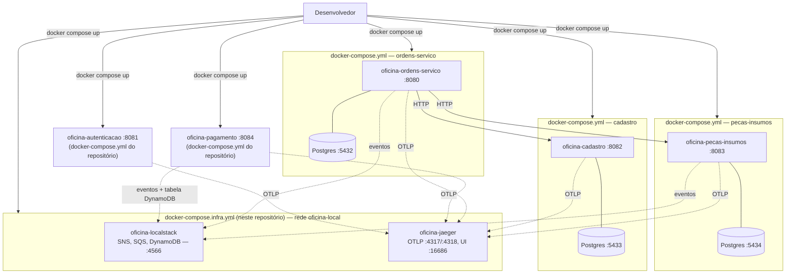
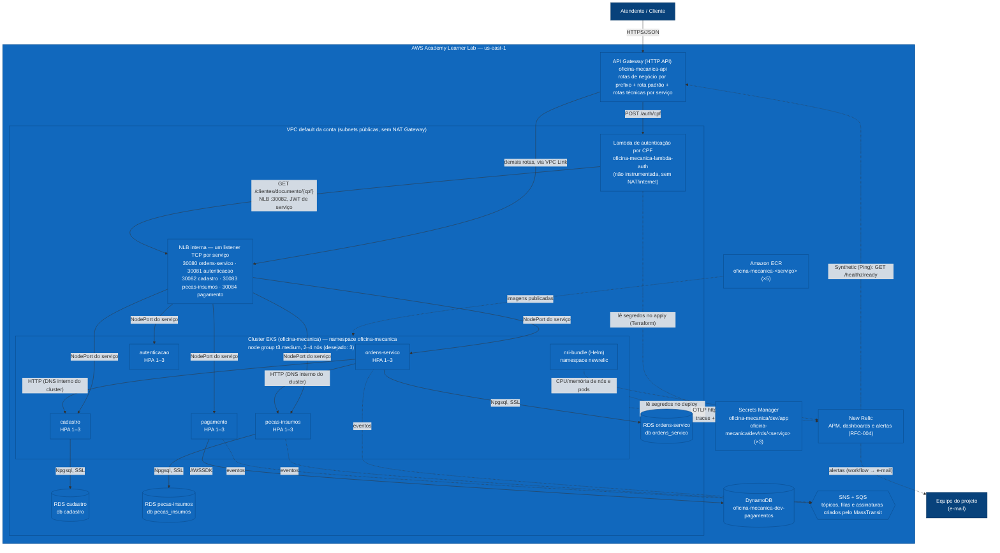

# Desenho — Infraestrutura

> Existem **dois ambientes**: o **local de desenvolvimento** (`docker compose`, sem Kubernetes) e o
> **de produção, na nuvem** — AWS Academy Learner Lab. A infraestrutura de nuvem é persistente e
> gerenciada por repositórios Terraform próprios, não recriada a cada execução do CI. Na Fase 4 ela
> sustenta **cinco serviços** (um Deployment, um ECR e um listener da NLB cada), três bancos
> PostgreSQL, uma tabela DynamoDB e a mensageria SNS/SQS.
>
> Diagramas em [Mermaid](https://mermaid.js.org/) — renderizam nativamente no GitHub.

---

## Ambiente local de desenvolvimento

Cada repositório de serviço tem o **próprio `docker-compose.yml`**, com o serviço e as dependências
exclusivas dele (o PostgreSQL próprio). As dependências **compartilhadas** ficam em
[`docker-compose.infra.yml`](../../../docker-compose.infra.yml), neste repositório: ele cria a rede
Docker `oficina-local` e sobe o **LocalStack** (SNS, SQS e DynamoDB) e o **Jaeger** (coletor OTLP +
UI). Ordem: `docker compose -f docker-compose.infra.yml up -d`, depois o `docker compose up` de cada
serviço desejado. Os serviços se chamam por nome de contêiner na rede `oficina-local`.

Sem Kubernetes localmente — a validação dos manifestos acontece contra o cluster de nuvem. Valores de
desenvolvimento (banco `oficina` / `oficina-dev-pass`, segredo JWT de desenvolvimento, credenciais
do mock do Mercado Pago) estão nos `docker-compose.yml`.

---

## Ambiente de produção: nuvem (AWS Academy Learner Lab)

Provedor decidido no [RFC-002](../rfcs/002-escolha-do-provedor-de-nuvem.md) (**AWS**, conta AWS
Academy Learner Lab); tudo provisionado por Terraform.

### Roteamento do API Gateway

| Serviço | Rotas de negócio (sem reescrita de caminho) |
|---|---|
| autenticacao | `ANY /api/v1/auth/{proxy+}` |
| cadastro | `ANY /api/v1/clientes[/{proxy+}]`, `ANY /api/v1/veiculos[/{proxy+}]`, `ANY /api/v1/servicos[/{proxy+}]` |
| pecas-insumos | `ANY /api/v1/pecas-insumos[/{proxy+}]` |
| ordens-servico | `ANY /api/v1/ordens-servico[/{proxy+}]` e a rota **padrão** `ANY /{proxy+}` |
| pagamento | `ANY /api/v1/pagamentos/{proxy+}` |
| Lambda | `POST /auth/cpf` |

Cada serviço tem ainda uma **rota técnica com reescrita de caminho**, `ANY /<serviço>/{proxy+}`
(ex.: `GET /cadastro/healthz/ready` chega ao pod como `GET /healthz/ready`), usada pelos smoke tests e
para abrir o `openapi/v1.json` de cada serviço. Não há rota própria para `/mock/mercadopago/*`; porém
a rota técnica do Pagamento também o alcança — o mock exige as credenciais do cliente e um Bearer
(limitação registrada no README do serviço).

### Segredos, imagens e Kubernetes

- **Secrets Manager:** `oficina-mecanica/dev/app` (segredo JWT, senha do admin, credenciais do mock do
  Mercado Pago — criado por `infra-k8s`) e `oficina-mecanica/dev/rds/<serviço>` (um por banco —
  criados por `infra-db`). A pipeline de cada serviço monta o `Secret` `<serviço>-secrets` no deploy;
  nenhum segredo é commitado.
- **ECR:** um repositório por serviço (`oficina-mecanica-<serviço>`); a tag da imagem é o SHA do commit.
- **Kubernetes:** namespace `oficina-mecanica` compartilhado; por serviço, ConfigMap, Deployment,
  Service **NodePort** (80 → 8080), HPA de 1 a 3 réplicas a 50% de CPU, probes `/healthz/live` e
  `/healthz/ready`, requests 100m/256Mi e limits 500m/512Mi. O `nri-bundle` é instalado apenas pela
  pipeline do `ordens-servico`.
- **Mensageria:** SNS/SQS são criados pelo próprio MassTransit na subida de cada serviço; os pods usam
  a cadeia padrão de credenciais do SDK (role do nó do EKS), sem endpoint customizado.
- **Dimensionamento:** `t3.medium`; o fator limitante é o limite de pods por nó e a memória. Três nós
  acomodam os cinco serviços com até três réplicas cada, os pods de sistema e o `nri-bundle`.

### Topologia de repositórios

O Terraform se divide em três repositórios — `oficina-mecanica-infra-k8s` (cluster, rede, NLB, API
Gateway, ECR por serviço, segredo da aplicação), `oficina-mecanica-infra-db` (três RDS PostgreSQL, a
tabela DynamoDB e os segredos dos bancos) e `oficina-mecanica-lambda-auth` (a Function, seu security
group e sua rota no API Gateway) — que publicam outputs consumidos entre si via
`terraform_remote_state`. Nenhum cria VPC própria: todos usam a VPC default da conta via `data`
sources ([RFC-002](../rfcs/002-escolha-do-provedor-de-nuvem.md), "Atualização — VPC default"). O
código, a imagem e os manifestos de cada serviço ficam no repositório do próprio serviço
([ADR-005](../adrs/005-quatro-repositorios-e-estrategia-de-branches.md),
[ADR-009](../adrs/009-decomposicao-em-microsservicos.md)).

**Diferenças em relação ao ambiente local:**

| Peça | Local (`docker compose`) | Nuvem (produção) |
|---|---|---|
| Orquestração | Nenhuma (contêineres soltos) | **EKS**, com HPA por serviço |
| Bancos PostgreSQL | um contêiner por serviço, volume Docker | **uma instância RDS por serviço**, gerenciada, fora do cluster |
| NoSQL (Pagamento) | DynamoDB no **LocalStack** | **DynamoDB** (tabela criada pelo Terraform) |
| Mensageria | SNS/SQS no **LocalStack** (`Mensageria__ServiceUrl`) | **SNS/SQS** reais, credenciais do nó |
| Entrada de tráfego | portas expostas no host (8080–8084) | **API Gateway** → VPC Link → NLB interna |
| Autenticação por CPF | JWT assinado manualmente (sem a Function) | **Lambda** real, atrás do API Gateway |
| Segredos | variáveis de ambiente do `docker-compose.yml` | **Secrets Manager**, resolvidos no apply/deploy |
| Telemetria (destino) | Jaeger local | **New Relic** — OTLP + `nri-bundle` (RFC-004) |
| Terraform | não se aplica | state remoto (S3), um repositório por peça de infraestrutura |

A aplicação exporta OTLP e expõe health checks igualmente nos dois ambientes — só mudam o destino do
OTLP e o que está por trás do Kubernetes. Ver
[Observabilidade no README](../../../README.md#observabilidade-opentelemetry--new-relic) e
[`metricas.md`](../metricas.md).
