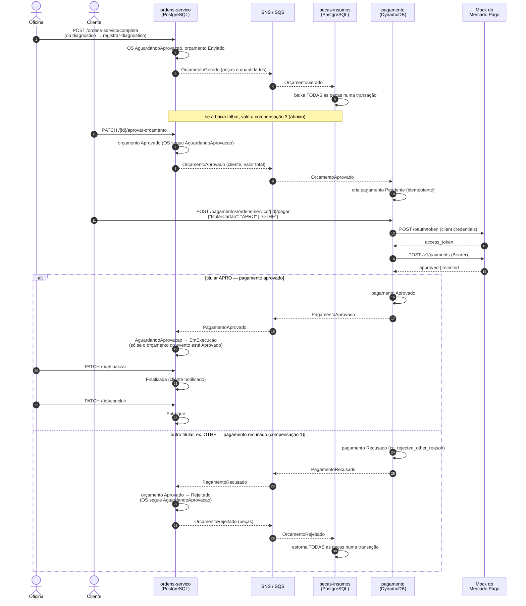
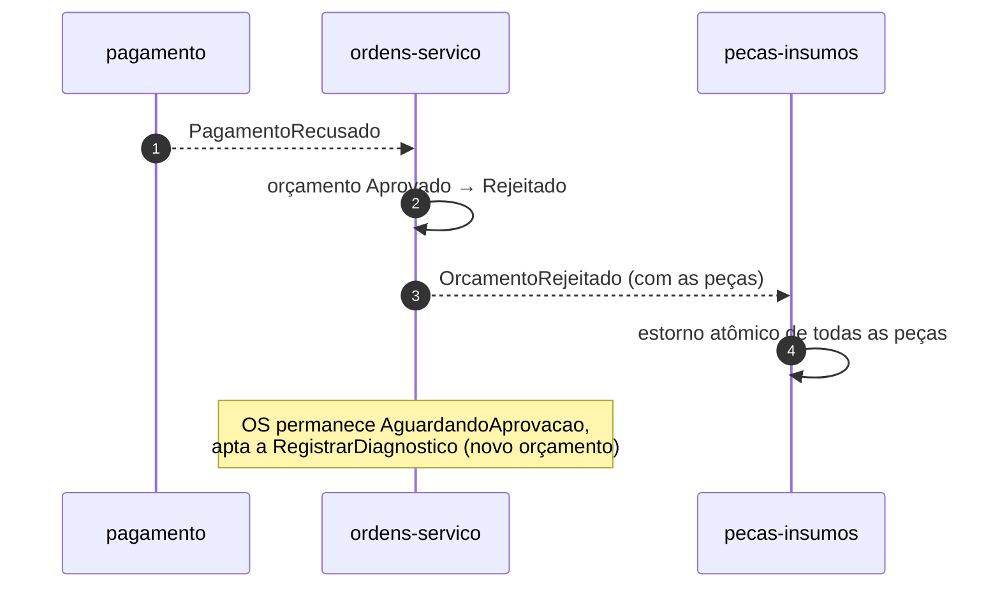
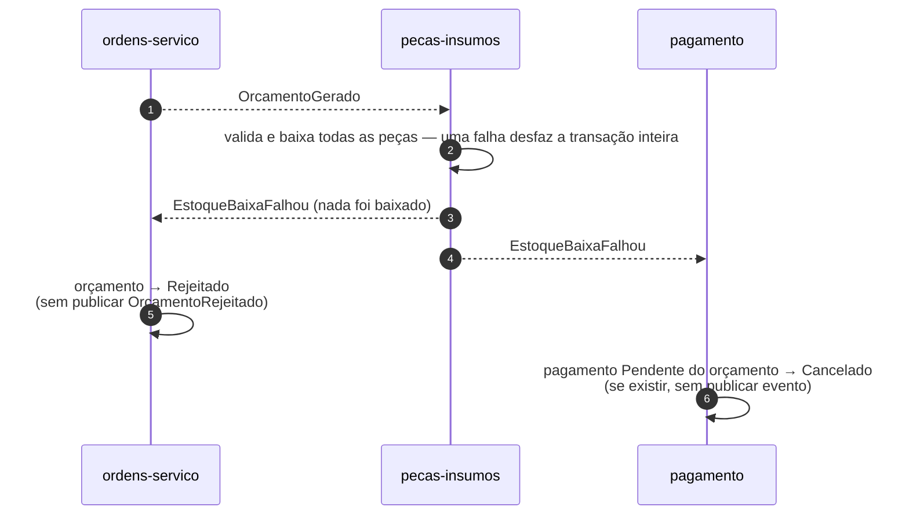

# Desenho — Saga da Ordem de Serviço

> A Fase 4 divide o sistema em cinco microsserviços ([ADR-009](../adrs/009-decomposicao-em-microsservicos.md)).
> O fluxo da ordem de serviço (OS) atravessa três deles — **OrdensServico**, **PecasInsumos** e
> **Pagamento** — e, como cada um tem o próprio banco, não existe transação única: a consistência
> vem de uma **Saga coreografada**, em que cada serviço reage a eventos de integração e, quando
> uma etapa falha, os outros serviços **desfazem** o que já fizeram (compensação).
> A decisão e as alternativas estão na [ADR-010](../adrs/010-saga-coreografada-com-masstransit.md);
> este documento descreve o fluxo **como o código o implementa**.
>
> Diagramas em [Mermaid](https://mermaid.js.org/) — renderizam nativamente no GitHub.

---

## Participantes

| Serviço | Papel na Saga | Banco | Fila(s) que consome |
|---|---|---|---|
| **ordens-servico** | dona da OS e do orçamento; publica `OrcamentoGerado`, `OrcamentoAprovado` e `OrcamentoRejeitado`; decide o status da OS | PostgreSQL | `ordens-servico-pagamento-aprovado`, `ordens-servico-pagamento-recusado`, `ordens-servico-estoque-baixa-falhou` |
| **pecas-insumos** | dona do estoque; baixa e estorna as peças de um orçamento de forma atômica; publica `EstoqueBaixaFalhou` | PostgreSQL | `pecas-insumos-orcamento-gerado`, `pecas-insumos-orcamento-rejeitado` |
| **pagamento** | cobra o orçamento aprovado no mock do Mercado Pago; publica `PagamentoAprovado` e `PagamentoRecusado` | DynamoDB | `pagamento-orcamento-aprovado`, `pagamento-estoque-baixa-falhou` |

Cadastro e Autenticação não participam da Saga: o Cadastro só responde a consultas HTTP da OS (e da
Lambda) e a Autenticação só emite o token da oficina.

O transporte é SNS (um tópico por tipo de evento) + SQS (uma fila por consumidor), configurado pelo
MassTransit. As filas são privadas de cada serviço; o que liga os serviços é o **tipo da mensagem**
(`OficinaMecanica.Contracts.IntegrationEvents.<Evento>IntegrationEvent`), por isso a biblioteca de
contratos é uma cópia idêntica em todos os repositórios.

---

## Fluxo completo: abertura → orçamento → aprovação → pagamento → execução → entrega

Pontos que o diagrama resume:

- **A OS não ganha status novo.** O ciclo de status do pagamento (`Pendente` → `Aprovado` |
  `Recusado` | `Cancelado`) é interno ao serviço de Pagamento, do mesmo jeito que o orçamento tem o
  próprio ciclo dentro da OS. A transição para `EmExecucao` acontece **somente** pelo evento
  `PagamentoAprovado` — a rota `PATCH /api/v1/ordens-servico/{id}/executar` deixou de existir.
- **Pagamento depois da aprovação, antes da execução.** O cliente paga pelo canal digital da oficina
  (a rota `/pagar` do serviço Pagamento) e a OS só é executada com o pagamento aprovado.
- **A baixa de estoque acontece cedo** (já na geração do orçamento) e em paralelo à decisão do
  cliente, o que reserva as peças enquanto o orçamento espera aprovação — e é por isso que
  rejeitar o orçamento, por qualquer caminho, precisa estornar.
- **Os eventos são publicados depois do commit** do banco do serviço que os origina (comportamento
  do `TransactionBehavior`, mantido da Fase 3).

---

## Eventos de integração

Contratos em `src/Contracts/OficinaMecanica.Contracts` (idênticos nos repositórios que publicam ou
consomem).

| Evento | Publicado por | Quando | Consumido por | Efeito no consumidor |
|---|---|---|---|---|
| `OrcamentoGerado` | ordens-servico | orçamento gerado (abertura completa ou registro de diagnóstico) | pecas-insumos | baixa **atômica** de todas as peças; se não for possível, publica `EstoqueBaixaFalhou` |
| `OrcamentoRejeitado` | ordens-servico | cliente rejeita o orçamento **ou** o pagamento é recusado | pecas-insumos | estorno atômico de todas as peças |
| `EstoqueBaixaFalhou` | pecas-insumos | a baixa não pôde ser feita (nada foi baixado) | ordens-servico; pagamento | **OS:** orçamento → `Rejeitado`, **sem** publicar `OrcamentoRejeitado` (nada a estornar). **Pagamento:** se houver pagamento `Pendente` daquele orçamento, vai a `Cancelado`, sem publicar evento; senão, só registra log |
| `OrcamentoAprovado` | ordens-servico | cliente aprova o orçamento | pagamento | cria o pagamento `Pendente` |
| `PagamentoAprovado` | pagamento | o mock do Mercado Pago aprova | ordens-servico | OS `AguardandoAprovacao` → `EmExecucao`, **só se** o orçamento do evento estiver `Aprovado`; senão, log de erro + métrica e a OS não é executada |
| `PagamentoRecusado` | pagamento | o mock do Mercado Pago recusa | ordens-servico | **compensação:** orçamento `Aprovado` → `Rejeitado` + publica `OrcamentoRejeitado`; a OS segue `AguardandoAprovacao`, apta a novo diagnóstico |

Os consumidores toleram **reentrega**: se o estado já reflete o evento (OS já `EmExecucao`,
pagamento já existente, orçamento já `Rejeitado`), registram log e retornam sem erro.

---

## Compensações

Compensação é **desfazer, em outro serviço, o que já foi feito**. Há três na Saga (mais o
cancelamento do pagamento pendente, que é a mesma falha vista pelo Pagamento).

### 1. Pagamento recusado → orçamento rejeitado → estorno das peças

Sem essa compensação as peças ficariam reservadas indefinidamente por um orçamento que nunca será
executado. A OS volta a aceitar um novo diagnóstico porque `RegistrarDiagnostico` já aceita OS
`AguardandoAprovacao` cujos orçamentos estão todos rejeitados.

### 2. Rejeição pelo cliente → estorno das peças

O cliente chama `PATCH /{id}/rejeitar-orcamento`; a OS rejeita o orçamento e publica
`OrcamentoRejeitado`; o PecasInsumos estorna. Nenhum pagamento existe nesse ponto (o
`OrcamentoAprovado` ainda não foi publicado).

### 3. Falha na baixa de estoque → orçamento rejeitado, sem estorno

A baixa é **atômica**: carrega todas as peças, valida o estoque de todas e decrementa todas em uma
única unidade de trabalho; se qualquer peça não existir ou não tiver estoque, nada é persistido.
Por isso não há o que estornar — a OS só rejeita o orçamento, sem `OrcamentoRejeitado`. O
Pagamento também escuta o evento para cobrir a corrida em que o cliente aprovou o orçamento antes
de a falha chegar: o pagamento `Pendente` passa a `Cancelado` e deixa de ser pagável (`/pagar`
responde 404).

### O que é compensação e o que é tratamento de erro

| Situação | Tratamento | É compensação? |
|---|---|---|
| Exceção técnica ao processar uma mensagem (banco indisponível, timeout) | **Retry** do MassTransit: três reentregas após 1 s, 5 s e 10 s, antes de desistir | Não — é tentativa de completar a mesma etapa |
| Retry esgotado | O MassTransit move a mensagem para a fila `<fila>_error`; o reprocessamento é manual (fora do escopo) | Não |
| Pagamento recusado, orçamento rejeitado pelo cliente, baixa de estoque impossível | Estado de negócio revertido em **outro serviço** (estorno, rejeição, cancelamento) | **Sim** |
| E-mail do orçamento não pôde ser montado ou enviado | Falha capturada, registrada em log e na métrica `oficina.integracoes.falhas`; a abertura da OS e a publicação de `OrcamentoGerado` seguem | Não — é registro de erro |
| `PagamentoAprovado` de um orçamento que já não está `Aprovado` | Log de erro + métrica; a OS **não** é executada | Não — é registro de erro |

---

## Limitações conhecidas

Itens fora do escopo desta fase, registrados como evolução futura:

- **Sem outbox.** O evento é publicado depois do commit do banco, mas as duas operações não são
  atômicas: se a publicação falhar depois de gravar, o evento não é reenviado.
- **Sem DLQ gerenciada** nem reprocessamento automático das mensagens da fila `_error`.
- **Corrida entre pagamento e falha de estoque.** Se `EstoqueBaixaFalhou` e um `/pagar` chegarem
  quase juntos, vale o que gravar primeiro; se o pagamento vencer, a OS recebe `PagamentoAprovado`
  de um orçamento que já rejeitou e o ignora (a regra de execução exige orçamento `Aprovado`).
- **Pagamento sem timeout.** Um pagamento `Pendente` não expira; o orçamento fica `Aprovado` até
  o cliente pagar, ser recusado ou a falha de estoque chegar.
- **Estorno do pagamento** não existe: o mock não tem essa operação e nenhuma compensação a exige
  (um pagamento aprovado leva a OS à execução, e nada o desfaz depois).
