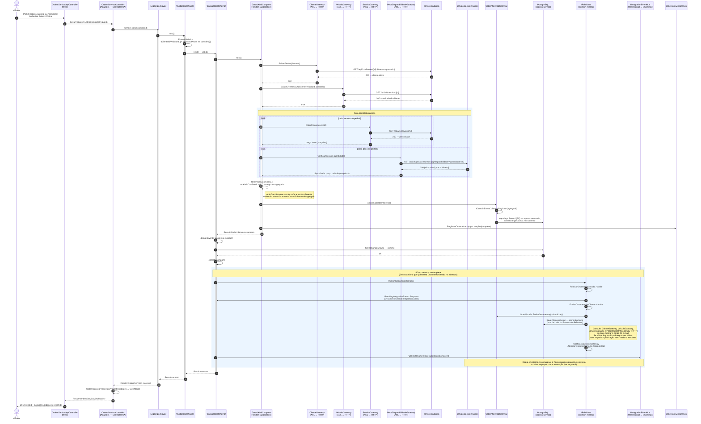
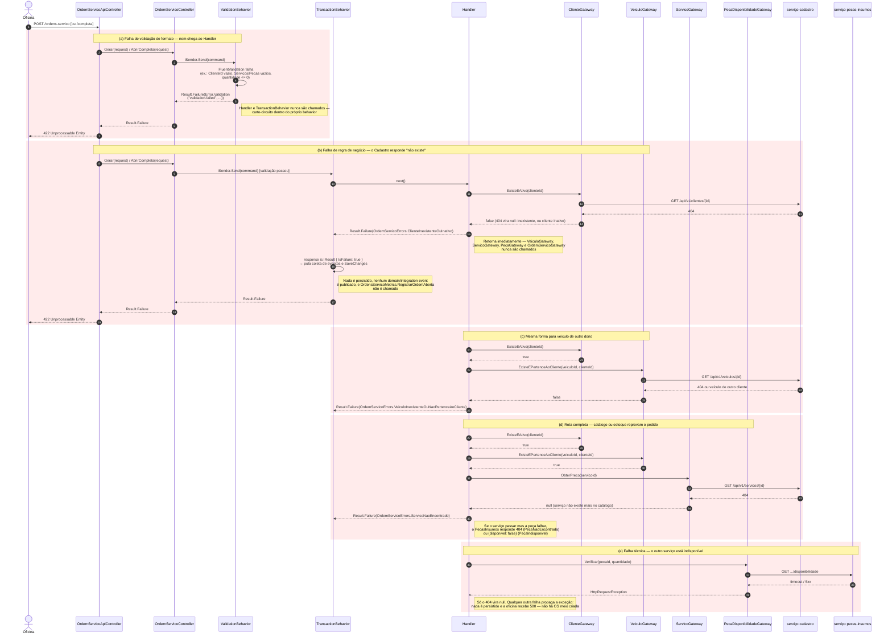

# Desenho — Sequência de Abertura de Ordem de Serviço

> Diagrama de sequência do fluxo de **abertura de uma OS** no serviço **OrdensServico**, já na
> arquitetura distribuída da Fase 4. Reflete o código como ele existe hoje — não um desenho
> idealizado. Fonte de verdade:
> [`OrdemServicoApiController`](../../../src/Modules/OrdensServico/OrdensServico.Web/Controllers/OrdemServicoApiController.cs),
> [`OrdemServicoController`](../../../src/Modules/OrdensServico/OrdensServico.Adapters/Controllers/OrdemServicoController.cs),
> os handlers `GerarOrdemServico` / `AbrirOrdemServicoCompleta`, os Gateways de ACL em
> `OrdensServico.Adapters/Gateways/`, os *behaviors* em `SharedKernel.Application/Behaviors/`, os
> domain events do módulo e o adapter MassTransit em `OrdensServico.Infrastructure/Messaging/`. Ver
> também [`clean-architecture.md`](../clean-architecture.md) (vocabulário Controller CA / Gateway /
> Presenter), [`decisoes.md`](../decisoes.md) (ciclo de vida da OS), [`metricas.md`](../metricas.md)
> (instrumento `oficina.ordens_servico.abertas`) e [`saga.md`](saga.md) (o que acontece com o
> evento `OrcamentoGerado` depois da abertura).

**Ator:** a **oficina** (atendente/mecânico), autenticada com token de papel `Oficina`
(`[Authorize(Roles = "Oficina")]` nas duas rotas). O cliente não abre OS — ele só participa mais
adiante, aprovando ou rejeitando o orçamento e pagando.

**Duas rotas de abertura**, convergindo para o mesmo pipeline:

| Rota | Command | O que já entra pronto |
|---|---|---|
| `POST /api/v1/ordens-servico` | `GerarOrdemServicoCommand` | Nada — a OS nasce em `Recebida`, sem itens, sem orçamento. Diagnóstico vem depois. |
| `POST /api/v1/ordens-servico/completa` | `AbrirOrdemServicoCompletaCommand` | Serviços e peças já informados — a OS nasce direto em `AguardandoAprovacao`, com orçamento gerado e enviado; a baixa de estoque é pedida por evento. |

**O que mudou na Fase 4:** o Cadastro e o PecasInsumos deixaram de ser módulos no mesmo processo. Os
Gateways de ACL continuam sendo as *ports* da Application, mas os *adapters* agora fazem **chamadas
HTTP** a esses serviços (repassando o `Authorization` da requisição de entrada), e o
`IIntegrationEventBus` publica no **SNS/SQS** em vez de chamar os handlers em processo — a baixa de
estoque passou a ser **assíncrona**, executada pelo PecasInsumos.

---

## Diagrama 1 — Caminho feliz (as duas rotas)

---

## Diagrama 2 — Caminhos de erro

As regras de negócio mais interessantes do fluxo estão nas falhas, não no caminho feliz: é aqui
que a ACL protege o agregado de nascer em estado inconsistente (cliente inexistente, veículo de
outro dono, serviço ou peça que não existem mais no catálogo, peça sem estoque) — e que se vê o que
muda quando o dono da informação é outro serviço, que pode estar indisponível.

---

## O que os diagramas mostram

**Duas rotas, um único pipeline.** `POST /ordens-servico` (simples) e `POST /ordens-servico/completa`
chegam ao mesmo `OrdemServicoApiController`, ao mesmo `OrdemServicoController` (Controller CA) e ao
mesmo pipeline MediatR — só o Command e o Handler mudam. A diferença de negócio é que a rota
completa já recebe serviços e peças, então o agregado nasce com orçamento gerado (evento
`OrcamentoGerado`, status `AguardandoAprovacao`); a rota simples nasce vazia em `Recebida`, sem
levantar nenhum domain event — o orçamento só existe quando `RegistrarDiagnostico` for chamado
depois.

**O pipeline do MediatR envolve o Handler em camadas.** A ordem de registro em `OrdemServicoModule`
é `Logging → Validation → Transaction`, e cada behavior chama `next()` para entrar na camada de
dentro: `LoggingBehavior` mede o tempo total; `ValidationBehavior` roda o `FluentValidation` do
Command **antes** de deixar a requisição prosseguir e curto-circuita com `Result.Failure` sem nunca
invocar o Handler; `TransactionBehavior` só persiste e só publica eventos **depois** que o Handler
retorna sucesso — se o `Result` vier `IsFailure`, ele pula `SaveChangesAsync` e a publicação de
eventos inteiramente (ver Diagrama 2, caminho b).

**Por que a comunicação com Cadastro e PecasInsumos passa por Gateway/ACL.** A Application nunca
conhece os outros serviços: o Handler depende de uma *port* no vocabulário do próprio serviço
(`IClienteGateway`, `IVeiculoGateway`, `IServicoGateway`, `IPecaDisponibilidadeGateway`, todas em
`OrdensServico.Application/Gateways`), e quem a implementa é um *adapter* em
`OrdensServico.Adapters/Gateways` que faz a chamada HTTP e traduz a resposta do outro serviço para o
formato que OrdensServico entende. É o Anti-Corruption Layer descrito em
[`clean-architecture.md`](../clean-architecture.md) §4.3: se o contrato HTTP do Cadastro mudar, só o
adapter muda — o Handler e o Domain continuam intocados. O `HttpClient` é tipado e passa por um
`DelegatingHandler` que repassa o `Authorization` da requisição de entrada, de modo que o serviço
chamado aplica a própria autorização (todas essas rotas são do papel `Oficina`). O 404 do outro
serviço vira `null` no gateway; qualquer outra falha propaga como `HttpRequestException`
(Diagrama 2, caminho e).

**Eventos: domain event dentro do serviço, integration event entre serviços.** `OrcamentoGerado` é
um domain event do agregado `OrdemServico` — só existe dentro de `OrdensServico`, publicado via
`IPublisher` depois do commit (nunca antes, ver [`decisoes.md`](../decisoes.md#transactionbehavior--orquestração-pós-commit)).
Ele tem dois consumidores registrados, ambos rodando na mesma publicação: `PublicarOrcamentoGerado`
(enfileira `OrcamentoGeradoIntegrationEvent` em `IPendingIntegrationEvents`, publicado logo em
seguida pelo `TransactionBehavior` no `IIntegrationEventBus`) e `EnviarOrcamentoAoCliente` (muta o
próprio agregado — chama `EnviarOrcamento()` e persiste com um `SaveChangesAsync` próprio, fora da
UoW original — e dispara a notificação simulada ao cliente). **A falha ao montar ou enviar o e-mail é
capturada, registrada em log e na métrica `oficina.integracoes.falhas`**, e não impede a publicação
do `OrcamentoGeradoIntegrationEvent` nem muda a resposta — a Saga não pode parar por causa de uma
notificação.

O `IIntegrationEventBus` é quem cruza a fronteira de serviço: o adapter MassTransit publica o evento
no SNS, e o PecasInsumos o consome de uma fila própria (`pecas-insumos-orcamento-gerado`), baixando
**todas** as peças numa única transação — se não for possível, publica `EstoqueBaixaFalhou` e a OS
rejeita o orçamento. Nada disso acontece dentro da requisição de abertura: a resposta `201` não
espera a baixa. O fluxo seguinte (aprovação, pagamento, execução) e as compensações estão em
[`saga.md`](saga.md).

**Métrica de negócio.** `OrdensServicoMetrics.RegistrarOrdemAberta(tipo)` é emitida dentro do
Handler, logo após `IOrdemServicoGateway.Adicionar` — antes do commit do `TransactionBehavior`, mas
só no caminho de sucesso. Nenhuma falha de validação ou de ACL chega a incrementar o contador
`oficina.ordens_servico.abertas` (ver [`metricas.md`](../metricas.md)); é assim que o dashboard de
volume diário separa `simples` de `completa` sem contar tentativas rejeitadas.
