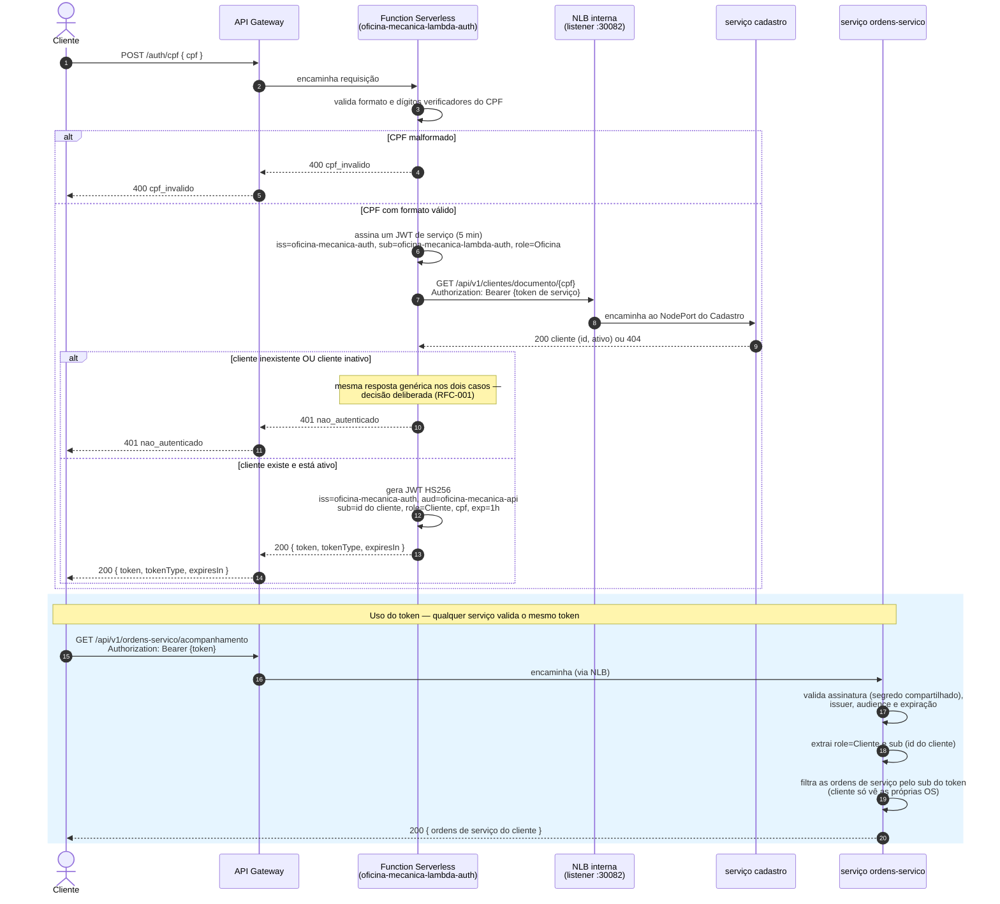
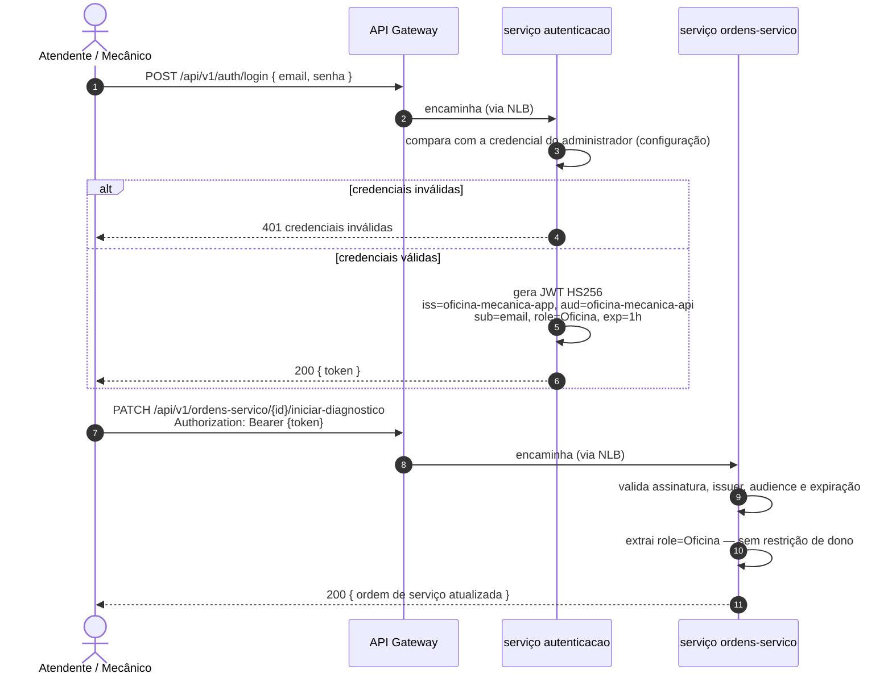

# Desenho — Sequência de Autenticação

> Diagrama de sequência dos dois fluxos de autenticação do sistema distribuído (**Fase 4**): o
> cliente por CPF (Function Serverless) e a oficina por e-mail e senha (serviço `autenticacao`).
> Diagramas em [Mermaid](https://mermaid.js.org/) — renderizam nativamente no GitHub.
>
> Fonte de verdade: [RFC-001 — Estratégia de autenticação](../rfcs/001-estrategia-de-autenticacao.md)
> (contrato de claims em §4.1, mapa de rotas por papel em §4.2), com as decisões detalhadas em
> [ADR-001](../adrs/001-jwt-hs256-segredo-compartilhado.md),
> [ADR-003](../adrs/003-dois-emissores-e-autorizacao-por-papel.md) e
> [ADR-011](../adrs/011-lambda-consulta-o-cadastro-por-http.md) (que substitui a
> [ADR-002](../adrs/002-lambda-le-o-banco-diretamente.md)).

---

## Quem emite e quem valida

| Papel | Quem emite | Credencial | `iss` | Quem valida |
|---|---|---|---|---|
| `Oficina` | serviço **autenticacao** (`POST /api/v1/auth/login`) | e-mail + senha | `oficina-mecanica-app` | cada serviço, com o segredo compartilhado |
| `Cliente` | **Function Serverless** (`POST /auth/cpf`) | CPF | `oficina-mecanica-auth` | cada serviço, com o segredo compartilhado |

Os cinco serviços **apenas validam** tokens (assinatura HS256, `issuer`, `audience` e expiração); o
`autenticacao` e a Function são os únicos emissores. A Function ainda precisa de um token próprio, de
serviço, para consultar o Cadastro (fluxo 1).

---

## Fluxo 1 — Cliente autentica por CPF

### Passo a passo e decisões

**1–3.** O cliente informa o CPF ao API Gateway, que roteia `POST /auth/cpf` à Function Serverless.

**4–5.** A Function valida o CPF (formato e dígitos verificadores) antes de qualquer chamada. CPF
malformado responde **400** sem consulta alguma — não há como um documento inválido revelar informação
sobre cadastro.

**6–9.** Com CPF válido, a Function **consulta o serviço de Cadastro por HTTP**, e não mais o banco
([ADR-011](../adrs/011-lambda-consulta-o-cadastro-por-http.md)): nenhum serviço acessa o banco de outro.
A chamada vai pela NLB interna, dentro da VPC, e como as rotas do Cadastro exigem o papel `Oficina` a
Function assina um **JWT de serviço** de 5 minutos com o mesmo segredo compartilhado. A rota
`GET /api/v1/clientes/documento/{documento}` existe no Cadastro justamente para isso.

**10–12.** **Cliente inexistente e cliente inativo geram a mesma resposta — 401 genérico.** A igualdade
é intencional, conforme o comentário de intenção no próprio `AuthenticationService` da Function: se as
respostas fossem diferentes, o endpoint de login vazaria se um CPF está cadastrado, virando um
verificador de cadastro de terceiros.

**13–15.** Com cliente ativo, a Function assina o JWT em HS256 com o segredo compartilhado — decisão da
[ADR-001](../adrs/001-jwt-hs256-segredo-compartilhado.md), que mantém a mudança mínima (os serviços já
validam HS256). O preço é abrir mão do *JWT authorizer* nativo do API Gateway, que exige um emissor
OIDC; a validação fica inteiramente nos serviços. As claims seguem o contrato do RFC-001 §4.1: `sub` é
o id do cliente, `role=Cliente`, mais a claim `cpf`.

**16–20.** Do lado do serviço, o token chega como `Bearer` numa rota protegida. O serviço valida
assinatura, `issuer` e `audience`, extrai `role` e `sub` e usa o `sub` para filtrar as ordens de serviço:
um cliente autenticado só enxerga as próprias OS (`ClaimsPrincipalExtensions.ObterClienteIdDoSolicitante`,
comparado contra o dono da OS nos handlers de `ordens-servico`). O serviço de Pagamento aplica a mesma
regra ao `ClienteId` do pagamento. Quando a comparação falha, a resposta é **403**, não 404 — o recurso
existe, só não pertence a quem pediu.

---

## Fluxo 2 — Oficina autentica por e-mail e senha

### Passo a passo e decisões

O login da oficina é emitido pelo serviço **autenticacao**, que não tem banco: a credencial do
administrador vem de configuração (`Auth__AdminEmail`, `Auth__AdminSenha`; na nuvem, a senha vem do
Secrets Manager) — trocar por múltiplos usuários está fora do escopo (RFC-001 §6). O token da oficina
usa `iss=oficina-mecanica-app`, distinto do `iss=oficina-mecanica-auth` da Function, para que os
serviços aceitem os dois emissores sem confundir um com o outro (`ValidIssuers` com dois valores, mesmo
segredo). O `sub` aqui é o e-mail do usuário, não um id, porque não existe cadastro de usuários da
oficina — só o administrador de configuração.

Rotas de `ordens-servico` fora de acompanhamento/aprovação/rejeição, todas as rotas de `clientes`,
`veiculos`, `servicos` e `pecas-insumos` e a consulta de pagamentos exigem `role=Oficina` (ou admitem
os dois papéis, como a consulta de pagamentos) e **não** têm restrição de dono para a oficina — ela
opera sobre qualquer cliente e qualquer OS, o que reflete o próprio domínio (RFC-001 §4.2).

---

## Onde os dois papéis se distinguem

O ponto de bifurcação é sempre o mesmo, dentro de cada serviço: o middleware de autenticação (JWT
Bearer) valida assinatura, `issuer` e `audience` de forma idêntica para os dois emissores — a diferença
está só em qual `issuer` bateu — e a claim `role`, lida via `RoleClaimType = "role"`, decide qual
`[Authorize(Roles = ...)]` a rota exige. Rotas com `Roles = "Cliente,Oficina"` (como
`GET /ordens-servico/{id}` e `/{id}/status`, e a consulta de pagamentos) aceitam os dois papéis, mas só o
papel `Cliente` carrega a restrição adicional de dono, aplicada explicitamente nos handlers de
Application (`AprovarOrcamentoHandler`, `RejeitarOrcamentoHandler`, `ObterOrdemServicoPorIdHandler`)
comparando `sub` com o `ClienteId` do recurso — nunca no controller, para manter a regra de negócio na
camada de Application.

---

## Por que dois emissores em vez de um só

A alternativa mais simples — um único fluxo, papel vindo de uma coluna no banco — foi descartada porque,
no fluxo por CPF, não existe segredo: o CPF é um identificador público, e qualquer papel que dependesse
só dele para conceder acesso administrativo trocaria uma falha de segurança por outra pior. A análise
completa das alternativas e por que a spec não é atendida com "tudo por CPF" está em
[ADR-003](../adrs/003-dois-emissores-e-autorizacao-por-papel.md).
